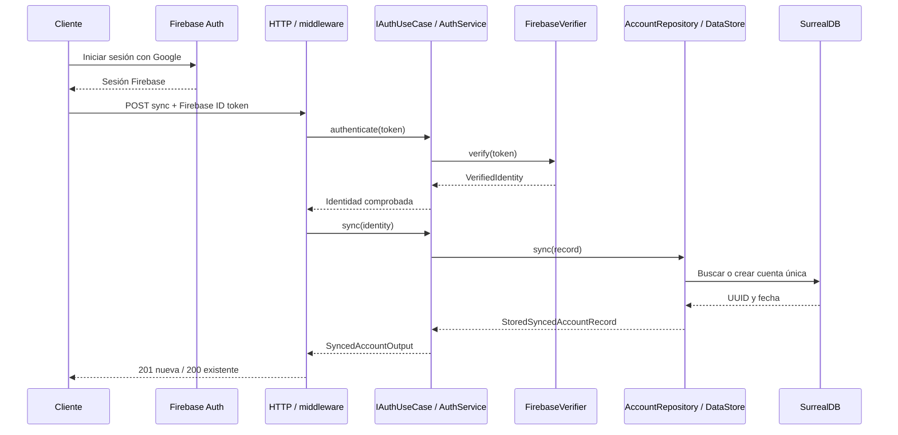

# 01 — Guía de estudio de auth Firebase y SurrealDB en nuestra arquitectura hexagonal

Fecha de creación: 2026-10-17
Estado: Guía retrospectiva contrastada con código y diff Git
Ámbito: Piezas añadidas y modificaciones de la integración aditiva
Revisión estudiada: `1c416da`, rama `feature/first-steps`.
Comparación: `14d8cc4..1c416da`.
Punto de restauración anterior: `backup/first-steps-antes-integrar-auth` → `14d8cc4`.
Relacionada con: [plan de adaptación](../../../docs/plans/02-integrar-auth-respetando-arquitectura-existente.md), [bitácora de implementación](../../../bitacora-construccion/03-integrar-auth-sin-retirar-backend-existente.md), [evidencia de la arquitectura original](../../../docs/fonts/auth/05-arquitectura-original-y-adaptacion-aditiva.md).

## 1. Qué estás estudiando y cómo usar esta guía

Se incorporó autenticación Firebase y una cuenta interna en SurrealDB siguiendo
los mismos límites que tu módulo de usuarios: dominio, puertos de entrada y
salida, servicio, casos de uso, records, DTO, repositorio, data store, entidad,
HTTP, configuración y bootstrap. Los siete crates originales permanecen.

La comparación exacta contiene **196 archivos: 164 añadidos y
32 modificados; 0 eliminados**. Entre ellos hay **69 archivos
Rust: 47 añadidos y 22 modificados**.
Una parte considerable de los añadidos son skills y referencias del proveedor.
El inventario del apartado 16 enumera los 196 archivos, incluidos esos
materiales. Esta guía fue creada después del commit y no forma parte de ese
conteo.

La numeración de lectura es pedagógica: expresa dependencias y comprensión,
no pretende reconstruir el orden cronológico exacto en que se escribieron las
líneas. Sigue primero los archivos con lógica; consulta los `mod.rs` al ubicar
cómo se publica cada módulo.

Una primera vuelta puede repartirse así:

| Vuelta | Apartados | Resultado que debes poder explicar |
| --- | --- | --- |
| Fundamentos | 2–5 | Distinguir identidad, cuenta, puertos, servicio y casos de uso. |
| Integraciones | 6–9 | Entender cómo se verifica Firebase, cómo se persiste y qué hace HTTP. |
| Composición y operación | 10–13 | Seguir configuración → recursos → servicios → servidor y separar las migraciones. |
| Comprobación | 14–16 | Leer las pruebas, localizar cada cambio y reconocer qué queda pendiente. |

## 2. El comportamiento completo antes de abrir archivos

1. El cliente inicia sesión con Google mediante Firebase.
2. Obtiene un **Firebase ID token** usando `user.getIdToken()`.
3. Envía `Authorization: Bearer <ID_TOKEN>` a la API.
4. El middleware pide a aplicación autenticar ese token.
5. El adaptador Firebase comprueba firma y claims; devuelve una identidad
   validada con proyecto y UID.
6. `POST /v1/auth/sync` obtiene o crea la cuenta interna correspondiente.
7. `GET /v1/auth/me` consulta esa cuenta sin crearla.



La identidad externa es `(firebase_project_id, firebase_uid)`; el identificador
público de nuestra aplicación es `account_id`, un UUID propio. La respuesta
HTTP contiene `account_id` y `created_at`. No recibe UID del body ni devuelve
el registro completo de la base.

| Petición | Efecto |
| --- | --- |
| `GET /health` | Comprueba liveness sin exigir token. |
| `POST /v1/auth/sync` | Primera vez 201; siguientes 200 con el mismo UUID. |
| `GET /v1/auth/me` | 200 si existe cuenta; 404 `account_not_synced` si aún no se sincronizó. |

`VerifiedIdentity::new` valida la forma de la identidad; la comprobación
criptográfica ocurre en `FirebaseVerifier`. Deben estudiarse como dos
responsabilidades distintas. ADC de gcloud autentica herramientas y no
sustituye al ID token de una persona que usa el cliente.

## 3. Primero: las piezas del dominio

| Orden | Archivo | Qué observar |
| --- | --- | --- |
| 1 | [crates/backend_domain/src/auth/auth_error.rs](../../backend_domain/src/auth/auth_error.rs) | Las categorías AuthError: token inválido, proveedor caído, cuenta no sincronizada y almacenamiento no disponible. |
| 2 | [crates/backend_domain/src/auth/verified_identity.rs](../../backend_domain/src/auth/verified_identity.rs) | Campos privados, constructor y getters. El tipo no implementa Deserialize desde una petición. |
| 3 | [crates/backend_domain/src/account/account_model.rs](../../backend_domain/src/account/account_model.rs) | Account solo contiene UUID propio y fecha de creación. |
| 4 | [crates/backend_domain/src/lib.rs](../../backend_domain/src/lib.rs) | Se publicaron auth y account conservando user y product. |

Aquí todavía no debes encontrar Warp, consultas ni clientes Firebase/SurrealDB.
La identidad decide **a quién pertenece** la operación; Account representa
**qué cuenta interna** devolvemos después de persistir o consultar.
Los `auth/mod.rs` y `account/mod.rs` registran estos módulos.

Al terminar este apartado, comprueba que puedes explicar por qué UID Firebase
y UUID de cuenta son dos valores distintos, y por qué recibir un UID por JSON
no bastaría para autenticar a alguien.

## 4. Después: los contratos de entrada y salida

El patrón es el mismo que ya tenías con `IUserUseCase` e `IUserRepository`.
Lee primero qué promete hacer aplicación y después qué necesita del exterior.

| Orden | Archivo | Qué observar |
| --- | --- | --- |
| 1 | [crates/backend_application/src/auth_ports/in/auth_use_case.rs](../../backend_application/src/auth_ports/in/auth_use_case.rs) | IAuthUseCase ofrece authenticate, sync y current. Es la interfaz que consume HTTP. |
| 2 | [crates/backend_application/src/auth_ports/out/token_verifier.rs](../../backend_application/src/auth_ports/out/token_verifier.rs) | ITokenVerifier recibe un token y entrega VerifiedIdentity o AuthError. |
| 3 | [crates/backend_application/src/auth_ports/out/account/account_repository.rs](../../backend_application/src/auth_ports/out/account/account_repository.rs) | IAccountRepository ofrece sync y current sin exponer el SDK de base. |
| 4 | [crates/backend_application/src/auth_ports/out/account/records/input/sync_account_record.rs](../../backend_application/src/auth_ports/out/account/records/input/sync_account_record.rs) | SyncAccountRecord lleva identidad ya comprobada hacia persistencia. |
| 5 | [crates/backend_application/src/auth_ports/out/account/records/output/stored_account_record.rs](../../backend_application/src/auth_ports/out/account/records/output/stored_account_record.rs) | StoredAccountRecord devuelve UUID/fecha; StoredSyncedAccountRecord añade la marca interna created. |
| 6 | [crates/backend_application/src/auth_ports/mod.rs](../../backend_application/src/auth_ports/mod.rs) | La carpeta in se publica como inbound mediante #[path], igual que en user_ports. |

Los puertos outbound nombran capacidades que necesita aplicación; los
adaptadores concretos las implementan. Un controlador depende de
`Arc<dyn IAuthUseCase>`, no construye `FirebaseVerifier` ni un repositorio.

El record pertenece a la frontera aplicación–persistencia. No es el DTO JSON
que se entrega al navegador. Separarlos permite cambiar representación de
base sin cambiar los handlers.

## 5. Servicio, casos de uso y salida de aplicación

| Orden | Archivo | Qué observar |
| --- | --- | --- |
| 1 | [crates/backend_application/src/auth_application/dto/output/account_output.rs](../../backend_application/src/auth_application/dto/output/account_output.rs) | AccountOutput: salida neutral de aplicación, sin serialización HTTP. |
| 2 | [crates/backend_application/src/auth_application/dto/output/synced_account_output.rs](../../backend_application/src/auth_application/dto/output/synced_account_output.rs) | Incluye AccountOutput y created para decidir después entre 201 y 200. |
| 3 | [crates/backend_application/src/auth_application/use_cases/authenticate.rs](../../backend_application/src/auth_application/use_cases/authenticate.rs) | Delega en ITokenVerifier; limita la espera a 6 segundos. |
| 4 | [crates/backend_application/src/auth_application/use_cases/sync_account.rs](../../backend_application/src/auth_application/use_cases/sync_account.rs) | Construye el record, llama al repositorio con timeout de 5 segundos y transforma la salida. |
| 5 | [crates/backend_application/src/auth_application/use_cases/get_current_account.rs](../../backend_application/src/auth_application/use_cases/get_current_account.rs) | Solo consulta, con timeout de 5 segundos; no llama a sync ni crea una cuenta. |
| 6 | [crates/backend_application/src/auth_application/auth_service.rs](../../backend_application/src/auth_application/auth_service.rs) | AuthService<R,V> implementa IAuthUseCase y delega en los casos individuales, siguiendo UserService. |
| 7 | [tests/auth_application_tests.rs](../../../tests/auth_application_tests.rs) | Leer sus tres casos para comprobar fachada inbound, identidad, salida, errores y ausencia de escritura al autenticar. |

En la salida de persistencia se realiza esta transformación:

```text
StoredAccountRecord → Account (dominio) → AccountOutput (aplicación)
```

`created` es una decisión interna para informar si sync creó una cuenta.
No se serializa como un campo adicional en la respuesta pública.
Fíjate también en los `??` de los casos de uso: hay un resultado del timeout
y otro de la operación que se está esperando; ambos deben propagarse.

Antes de pasar a infraestructura, deberías poder seguir un caso de uso usando
solo un repositorio y un verificador falsos. Las pruebas de este apartado no
necesitan conectarse a Firebase ni a SurrealDB.

## 6. Adaptador Firebase: cómo una cadena pasa a ser una identidad

Lee [firebase_token_verifier.rs](../../backend_infrastructure/src/auth_infrastructure/firebase/firebase_token_verifier.rs)
en este orden:

1. `Claims`, `FirebaseClaims` y constantes: qué datos exige el token y qué
   proveedor está permitido.
2. `FirebaseVerifier::new`: construye un cliente compartido con TLS, límites
   de espera y endpoint fijo de certificados Google.
3. `verify`: exige RS256 y kid, obtiene la clave, verifica firma, proyecto,
   issuer y fechas, comprueba Google como proveedor y construye VerifiedIdentity.
4. `KeyCache` y `key`: reutilizan claves vigentes y coordinan una sola descarga
   concurrente; limitan renovaciones por kid desconocido y fallos del proveedor.
5. `download_keys`: limita tamaño, decodifica certificados y respeta el tiempo
   de caché informado por Google, considerando Age.

Leer el header JWT para elegir `kid` todavía no autentica al usuario.
La identidad se entrega después de verificar la firma y las condiciones.
Una clave vencida no se acepta indefinidamente si Google está caído.
Los errores de disponibilidad conservan una categoría distinta del token
inválido.

Después abre [firebase_tests.rs](../../backend_infrastructure/src/auth_infrastructure/firebase/firebase_tests.rs).
Ahí puedes relacionar token firmado, claims inválidos, caché, concurrencia,
renovaciones y fallos de certificados con los métodos anteriores. Las fixtures
RSA son artificiales y se usan exclusivamente en esas pruebas. El caso opt-in
de certificados reales consulta claves públicas de Google; no inicia sesión.

Para contexto documental, consulta
[la fuente Firebase/Rust](../../../docs/fonts/auth/01-firebase-auth-y-verificacion-rust.md).
La política actual acepta Google y no implementa verificación de revocación
por petición ni tenants. Los estados o baneos de usuario no forman parte de
esta entrega.

## 7. El contrato de datos antes de leer las consultas

Abre [database/schema/01-account.surql](../../../database/schema/01-account.surql).
Es el esquema deseado escrito en SurrealQL.

| Elemento | Motivo |
| --- | --- |
| `SCHEMAFULL` | El esquema define los campos de la cuenta. |
| `account_id`, tipo uuid, READONLY | UUID público estable. |
| `firebase_project_id` y `firebase_uid`, READONLY | Vínculo con la identidad comprobada. |
| `created_at`, datetime y DEFAULT | Fecha generada al crear el registro. |
| Índice único account_id | Evita duplicados del identificador público. |
| Índice único proyecto + UID | Evita dos cuentas para la misma identidad externa. |
| `PERMISSIONS NONE` | Restringe acceso de usuarios de registro/huéspedes; no sustituye los controles de identidad de nuestra API frente a un usuario de sistema. |

Esta tabla `account` tiene un propósito distinto del CRUD histórico de
usuarios con nombre, correo y contraseña. Incorporarla no importa perfiles
ni vincula cuentas por correo. Los módulos y pruebas anteriores siguen
existiendo; el traslado de ese CRUD es un alcance separado del plan 01.

## 8. Persistencia: entidad, data store y repositorio

| Orden | Archivo | Qué observar |
| --- | --- | --- |
| 1 | [crates/backend_infrastructure/src/auth_infrastructure/repositories/account_entity.rs](../../backend_infrastructure/src/auth_infrastructure/repositories/account_entity.rs) | AccountEntity usa tipos UUID/Datetime nativos del SDK y deriva SurrealValue; los convierte a StoredAccountRecord. |
| 2 | [crates/backend_infrastructure/src/auth_infrastructure/repositories/account_data_store.rs](../../backend_infrastructure/src/auth_infrastructure/repositories/account_data_store.rs) | AccountDataStore contiene SurrealQL, binds, lectura de resultados y CREATE ONLY. Comparar find con create. |
| 3 | [crates/backend_infrastructure/src/auth_infrastructure/repositories/account_repository.rs](../../backend_infrastructure/src/auth_infrastructure/repositories/account_repository.rs) | AccountRepository implementa IAccountRepository, mapea errores y resuelve sync idempotente y carreras. |
| 4 | [tests/auth_database.rs](../../../tests/auth_database.rs) | Las pruebas reales muestran identidad estable, unicidad, proyectos separados, concurrencia y cleanup. |

El recorrido de salida completo es:

```text
SurrealDB → AccountEntity → StoredAccountRecord
          → Account → AccountOutput → AccountResponseDto → JSON
```

Cada representación pertenece a una frontera concreta. `AccountEntity` conoce
el SDK; `StoredAccountRecord` expresa el resultado del puerto; `AccountOutput`
expresa el resultado de aplicación; `AccountResponseDto` controla el contrato
HTTP.

En `AccountDataStore::create`, el UUID se crea como tipo nativo y se pasa
mediante bind. En `find`, proyecto y UID también se pasan mediante parámetros.
El texto de una identidad no se concatena dentro de SurrealQL. Los `.check()`
comprueban errores de las consultas, además del resultado de transporte.

En `AccountRepository::sync` sigue estos escenarios:

1. La cuenta existe: se devuelve con `created=false`.
2. La cuenta no existe y create funciona: `created=true`.
3. Dos peticiones compiten: la unicidad decide el ganador; el repositorio
   relee la cuenta y puede reintentar conflictos reconocidos con límite.
4. El almacenamiento falla sin una cuenta recuperable: se devuelve
   `StorageUnavailable`.

La consulta previa no evita por sí sola una carrera. El índice único y el
manejo de conflictos son parte de la misma garantía. `current` tiene otro
contrato: si no encuentra cuenta devuelve `AccountNotSynced`.

## 9. HTTP: desde el encabezado hasta la respuesta

| Orden | Archivo | Qué observar |
| --- | --- | --- |
| 1 | [crates/backend_http/src/middleware/auth.rs](../../backend_http/src/middleware/auth.rs) | bearer_token exige un único Authorization válido; authenticate llama al puerto inbound y extrae VerifiedIdentity. |
| 2 | [crates/backend_http/src/auth_http/routes.rs](../../backend_http/src/auth_http/routes.rs) | Rutas sync/me, métodos, middleware auth y reutilización de with_service. |
| 3 | [crates/backend_http/src/auth_http/auth_controller.rs](../../backend_http/src/auth_http/auth_controller.rs) | Controladores delgados: llaman al caso de uso y deciden status/DTO. |
| 4 | [crates/backend_http/src/auth_http/dto/account_response_dto.rs](../../backend_http/src/auth_http/dto/account_response_dto.rs) | Únicamente account_id y created_at se serializan. |
| 5 | [crates/backend_http/src/auth_http/error.rs](../../backend_http/src/auth_http/error.rs) | AuthRejection adapta AuthError al mecanismo de rechazo de Warp. |
| 6 | [crates/backend_http/src/middleware/error.rs](../../backend_http/src/middleware/error.rs) | Se añadió handle_runtime_rejection; el handler anterior de usuarios se conserva. |
| 7 | [crates/backend_http/src/http_server/mod.rs](../../backend_http/src/http_server/mod.rs) | runtime_routes compone auth, health, CORS y el módulo de usuarios opcional. Server::new conserva la entrada anterior. |
| 8 | [tests/auth_http.rs](../../../tests/auth_http.rs) | Leer casos de sync/me, errores, preflight y composición con el fake original de usuarios. |

El endpoint sync no obtiene la identidad de un body. El middleware la entrega
al controlador después de autenticar. Repetir sync devuelve la misma cuenta;
me no realiza escritura.

| Caso | Respuesta auth |
| --- | --- |
| Token ausente o inválido | 401 invalid_token y WWW-Authenticate. |
| Proveedor sin claves utilizables | 503 auth_unavailable. |
| Cuenta aún no sincronizada | 404 account_not_synced. |
| Persistencia no disponible | 503 storage_unavailable. |

El runtime añade no-store y nosniff, y limita CORS a orígenes configurados.
El preflight OPTIONS no exige un token.

En `runtime_routes`, revisa el filtro `user_scope`: limita la recuperación
legacy a `/v1/users` sin consumir el prefijo que necesitan sus rutas originales.
Después exige autenticación y deja a ese módulo su handler de errores.
Así se conservan sus respuestas y un fallback legacy no reemplaza, por ejemplo,
el `account_not_synced` de auth.

## 10. Configuración: se ampliaron los tipos y loaders existentes

| Orden | Archivo | Cambio concreto |
| --- | --- | --- |
| 1 | [crates/backend_config/src/configuration/configuration.rs](../../backend_config/src/configuration/configuration.rs) | ServerConfiguration añade bind_address y cors_allowed_origins; mantiene port y la raíz Configuration. |
| 2 | [crates/backend_config/src/configuration/database/mod.rs](../../backend_config/src/configuration/database/mod.rs) | Añade SurrealAuthLevel y flags de recursos opcionales. Conserva PostgreSQL, SurrealDB y Qdrant. |
| 3 | [crates/backend_config/src/configuration/error/config_error.rs](../../backend_config/src/configuration/error/config_error.rs) | Añade InvalidSetting para rechazar valores incorrectos sin imprimir secretos. |
| 4 | [crates/backend_config/src/configuration/loader/mod.rs](../../backend_config/src/configuration/loader/mod.rs) | Environment toma un snapshot de .env y del proceso. Valida entorno, servidor, CORS y configuración del emulador; contiene tests nuevos. |
| 5 | [crates/backend_config/src/configuration/loader/auth.rs](../../backend_config/src/configuration/loader/auth.rs) | Configura Firebase con project_id sin exigir clave privada; conserva Clerk/Local y el campo histórico credentials_path. |
| 6 | [crates/backend_config/src/configuration/loader/databases.rs](../../backend_config/src/configuration/loader/databases.rs) | Carga nombres nuevos/aliases, alcance de acceso, protocolo y recursos opcionales. |
| 7 | [crates/backend_config/src/configuration/mod.rs](../../backend_config/src/configuration/mod.rs) | Conserva configuration::configuration; excepción local de Clippy evita renombrar ese módulo público. |

Las variables del proceso tienen prioridad sobre `.env` en la API. La lectura
no modifica el entorno global después de crear el runtime Tokio.

| Configuración | Efecto |
| --- | --- |
| AUTH_PROVIDER y FIREBASE_PROJECT_ID | Seleccionan Firebase y el proyecto que acepta el verificador. |
| APP_ENV, PORT, BIND_ADDRESS | Entorno, puerto y dirección de escucha. |
| CORS_ALLOWED_ORIGINS | Orígenes concretos del frontend, separados por comas. |
| SURREALDB_HOST/NAMESPACE/NAME/USER/PASSWORD/AUTH_LEVEL | Destino y credenciales del cliente de base. |
| LEGACY_USER_API_ENABLED | Activa explícitamente el CRUD anterior en desarrollo; requiere DATABASE_URL. |
| QDRANT_ENABLED | Inicializa Qdrant cuando se necesita, exigiendo su configuración. |

Los aliases antiguos SURREALDB_URL, SURREALDB_DATABASE y SURREALDB_USERNAME
siguen aceptados. Producción exige transporte seguro y acceso con alcance,
y no permite la API legacy. Los adaptadores anteriores continúan disponibles.

Los ejemplos versionados
[`.env.example`](../../../.env.example) y
[`.env.migrations.example`](../../../.env.migrations.example)
explican nombres y placeholders. Los valores privados no se reproducen en
esta guía. El runtime no consulta ADC ni usa credentials_path para verificar
los certificados públicos.

## 11. Conexión y arranque: aquí se conectan las piezas concretas

La dirección de dependencias del código no es el orden de arranque. El centro
conoce contratos; bootstrap conoce las implementaciones necesarias para
construir el sistema.

| Orden | Archivo | Qué seguir |
| --- | --- | --- |
| 1 | [crates/backend_infrastructure/src/database/surrealdb/connection.rs](../../backend_infrastructure/src/database/surrealdb/connection.rs) | create_connection usa Surreal<Any>, conserva HTTP(S)/WS(S), autentica según alcance y selecciona namespace/database. Timeout de 10 segundos. |
| 2 | [crates/backend_infrastructure/src/database/surrealdb/schema.rs](../../backend_infrastructure/src/database/surrealdb/schema.rs) | require_account_schema comprueba que account esté presente y accesible. No aplica migraciones ni certifica por sí solo todos los índices. |
| 3 | [crates/backend_bootstrap/src/bootstrap/resources/databases/mod.rs](../../backend_bootstrap/src/bootstrap/resources/databases/mod.rs) | DatabaseResources mantiene SurrealDB y convierte PostgreSQL/Qdrant en recursos opcionales según configuración. |
| 4 | [crates/backend_bootstrap/src/bootstrap/services/mod.rs](../../backend_bootstrap/src/bootstrap/services/mod.rs) | build_application_services conserva usuarios; build_runtime_services prepara auth y compone usuarios si se habilitan. |
| 5 | [crates/backend_bootstrap/src/bootstrap/services/auth.rs](../../backend_bootstrap/src/bootstrap/services/auth.rs) | build_auth_service construye FirebaseVerifier, AccountDataStore, AccountRepository y AuthService, devolviendo Arc<dyn IAuthUseCase>. |
| 6 | [crates/backend_bootstrap/src/bootstrap/error/mod.rs](../../backend_bootstrap/src/bootstrap/error/mod.rs) | Añade errores de selección/cliente auth a BootstrapError. |
| 7 | [crates/backend_bootstrap/src/bootstrap/app/mod.rs](../../backend_bootstrap/src/bootstrap/app/mod.rs) | run carga configuración, inicializa recursos, comprueba esquema y elige el servidor correspondiente. |
| 8 | [crates/backend_http/src/http_server/mod.rs](../../backend_http/src/http_server/mod.rs) | Server::with_runtime y try_run reciben servicios ya construidos; bind explícito y cierre graceful. |
| 9 | [src/main.rs](../../../src/main.rs) | Añade tracing y mantiene el punto de entrada hacia bootstrap con Tokio. |

Para entender `build_auth_service`, sigue esta cadena de construcción:

```text
ServiceResources.surrealdb ─→ AccountDataStore ─→ AccountRepository ─┐
AuthProviderConfiguration  ─→ FirebaseVerifier ────────────────────┤
                                                                 ↓
                                                   AuthService<Repo, Verifier>
                                                                 ↓
                                                    Arc<dyn IAuthUseCase>
                                                                 ↓
                                                       RuntimeServices / HTTP
```

`Arc` permite compartir una instancia sin reconstruir cliente, caché o servicio
por petición. `dyn IAuthUseCase` permite a HTTP usar el contrato sin conocer
los tipos concretos del repositorio y verificador.

En esta etapa también conviene abrir archivos **existentes que no se editaron**:
[AppResources](../../backend_bootstrap/src/bootstrap/resources/mod.rs),
[ServiceResources](../../backend_bootstrap/src/bootstrap/services/service_resources.rs),
[build_user_service](../../backend_bootstrap/src/bootstrap/services/user.rs) y
[with_service](../../backend_http/src/middleware/service.rs).
Son puntos de comparación para reconocer cómo auth encaja en la base anterior.

## 12. Migraciones: diferenciar esquema, historial y ejecución

Hay dos procesos separados: el proceso API ejecuta peticiones; SurrealKit
prepara y aplica cambios de esquema como tarea explícita. Estudia estos
archivos en este orden:

| Orden | Archivo o grupo | Qué representa |
| --- | --- | --- |
| 1 | [database/schema/01-account.surql](../../../database/schema/01-account.surql) | Estado deseado de account, legible y editable para cambios futuros. |
| 2 | [surrealkit.toml](../../../surrealkit.toml) | Configuración mínima del proyecto de esquema para la CLI fijada. |
| 3 | [database/setup.surql](../../../database/setup.surql) | Metadatos administrados por la herramienta, incluidos rollouts; no es el modelo de cuenta. |
| 4 | [manifest inicial .toml](../../../database/rollouts/20261018023549__initial_firebase_account.toml) | ID, hashes, fases y archivos que aplica el rollout. |
| 5 | [SQL congelado dentro del rollout](../../../database/rollouts/20261018023549__initial_firebase_account/schema/01-account.surql) | Copia exacta de la expansión revisada, referenciada por hash. |
| 6 | Snapshots generales y del rollout, enumerados en el inventario | Catálogo/estado de comparación que usa la herramienta para planificar y conservar el historial. |
| 7 | [scripts/db.py](../../../scripts/db.py) | Wrapper local que fija beta.6, instala con checksum y prepara el entorno de migración. |
| 8 | [.gitattributes](../../../.gitattributes) y [Makefile](../../../Makefile) | Conservación de bytes del SQL congelado y atajos operativos. |

El manifest inicial tiene una fase start que aplica el esquema y una fase de
rollback que retira las entidades introducidas. Su existencia no implica que
se pueda restaurar cualquier dato después de completar una migración.
Los hashes dependen del contenido congelado; no se corrige ese historial
editándolo como si fuera el esquema futuro.

Esta integración reutilizó esquema, manifest y snapshots de feature/auth
byte por byte. Según la comprobación registrada en la bitácora, el rollout
`20261018023549__initial_firebase_account` ya quedó completed y no había
pendientes. Esta guía no vuelve a conectarse ni a migrar la base para repetir
esa comprobación.

Para un cambio posterior, el recorrido conceptual es:

```text
Cambiar esquema deseado → generar plan → revisar manifest/SQL/snapshots
→ lint → aplicar al destino elegido → verificar → completar fase pendiente
```

| Comando, desde la raíz backend | Propósito y efecto |
| --- | --- |
| `make tools` | Descarga e instala la CLI fijada dentro de .tools/ con checksum. |
| `make db-lint` | Revisa coherencia de la cadena y hashes; no demuestra semántica de todas las consultas. |
| `make db-status` | Consulta el estado de rollouts de la base configurada. |
| `make db-plan NAME=nombre` | Genera archivos de un rollout contra snapshots; modifica el proyecto local. |
| `make db-up` | Aplica rollouts pendientes a la base seleccionada; puede dejar una fase por completar. |
| `make db-complete ROLLOUT=id` | Completa la fase correspondiente después de revisar y verificar. |

El API lee su entorno de ejecución; el wrapper de migraciones carga el
archivo seleccionado por DB_ENV_FILE, por defecto `.env.migrations`. En ese
wrapper, los valores de ese archivo se asignan al entorno del subproceso.
No confundir su resolución con la prioridad proceso–.env del loader Rust.
Los dos procesos tienen necesidades de credenciales diferentes.

`baseline` escribe metadatos/snapshots y no certifica por sí solo una base
arbitraria. El detalle de adopción y rollback está en el
[plan de migraciones](../../../docs/plans/04-esquema-y-migraciones-surrealkit.md).
El directorio `migrations/` de SQLx anterior permanece: sus archivos no se
aplican contra SurrealDB. Volver a un commit tampoco revierte el estado de
una base.

## 13. Dependencias, archivos de módulos y cambios pequeños

### Manifests y lockfile

El workspace conserva los siete crates. Sus Cargo.toml reciben dependencias
según responsabilidad: JWT/cliente HTTP en infraestructura; Serde/HTTP en el
adaptador HTTP; DTO y async en aplicación; lectura/URL en configuración.
SQLx, Qdrant y bcrypt continúan en el grafo.

[Cargo.toml](../../../Cargo.toml) declara versiones/features compartidas y
[Cargo.lock](../../../Cargo.lock) fija la resolución concreta. La selección remota del SDK
SurrealDB desactiva el motor embebido que arrastraba diskann; por eso el lockfile
pierde muchas líneas aunque no se eliminen archivos Rust ni adaptadores.
La diferencia registrada de Cargo.lock es 214 líneas añadidas y 2085 retiradas.

### Archivos mod.rs y lib.rs

Los nuevos mod.rs permiten que Rust encuentre los archivos de la feature.
Los lib.rs modificados publican auth/account junto con los módulos anteriores.
No necesitas atribuir lógica de negocio a cada archivo de registro de módulos.
El inventario los incluye para que puedas ubicar todos los cambios.

### Ajuste puntual en el data store PostgreSQL

[user_data_store.rs](../../backend_infrastructure/src/user_infrastructure/repositories/user_data_store.rs)
conserva sus consultas y operaciones. Se ordenó un import y se cambió
`.bind(&user_id)` por `.bind(user_id)` para quitar una referencia redundante que
Clippy detectó. El parámetro ya era `&Uuid`; el contrato del puerto y sus casos
de uso se mantienen.

### Docker, entorno e instrucciones para agentes

[docker-compose.yaml](../../../docker-compose.yaml) mantiene servicios/volúmenes y coloca PostgreSQL
y Qdrant bajo perfil legacy. SurrealDB usa versión fijada, entorno de bootstrap
y puertos locales. [.gitignore](../../../.gitignore) añade exclusión de herramientas y
backups privados, y permite versionar el ejemplo de migraciones.

Las skills de `.agents/skills/` y [skills-lock.json](../../../skills-lock.json) documentan capacidades
para el agente. No son dependencias del ejecutable Rust. Empieza por
[firebase-auth-basics](../../../.agents/skills/firebase-auth-basics/SKILL.md),
[surrealdb-docs](../../../.agents/skills/surrealdb-docs/SKILL.md),
[surrealql](../../../.agents/skills/surrealql/SKILL.md) y
[surrealkit](../../../.agents/skills/surrealkit/SKILL.md) cuando necesites sus referencias.
La ficha de SurrealKit registra diferencias entre la skill escrita para beta.3
y la CLI beta.6 realmente fijada en el proyecto.

## 14. Pruebas para estudiar cada responsabilidad

| Archivo | Qué demuestra y cómo leerlo |
| --- | --- |
| [tests/auth_application_tests.rs](../../../tests/auth_application_tests.rs) | Lee primero los fakes y luego sus tres tests: facade, identidad y mapeo; autenticación sin persistencia; errores del repositorio. |
| [tests/auth_http.rs](../../../tests/auth_http.rs) | Recorre una petición con Warp y dobles; verifica 201/200, me sin escritura, errores y compatibilidad con los fakes antiguos. |
| [crates/backend_infrastructure/src/auth_infrastructure/firebase/firebase_tests.rs](../../backend_infrastructure/src/auth_infrastructure/firebase/firebase_tests.rs) | Firma y claims usando clave artificial, caché y concurrencia; incluye consulta opt-in de certificados públicos. |
| [tests/auth_database.rs](../../../tests/auth_database.rs) | Usa SurrealDB real para invariantes, creación concurrente y cuenta de servicio; elimina su base/fila sintética. |
| Tests dentro de loader/mod.rs y middleware/auth.rs | Validación de entorno/aliases, producción y encabezados ambiguos. |
| [tests/fixtures/README.md](../../../tests/fixtures/README.md) | Explica certificado/clave artificiales y su uso en tests. |

Durante la implementación se ejecutó la suite completa con **64 casos
correctos: 42 originales y 22 nuevos**. La bitácora conserva el resultado,
las comprobaciones de arranque, rollout y límites. Este documento no afirma
haber repetido esos tests al escribir una guía Markdown.

Los archivos originales siguen en sus rutas y no se editaron:

- [tests/user_application_tests.rs](../../../tests/user_application_tests.rs): casos de uso, hashing y errores.
- [tests/user_http_tests.rs](../../../tests/user_http_tests.rs): contrato de rutas, body y validaciones.
- [tests/bootstrap_middleware_tests.rs](../../../tests/bootstrap_middleware_tests.rs): inyección y errores anteriores.
- [tests/database_integration_tests.rs](../../../tests/database_integration_tests.rs): ping PostgreSQL condicionado a
  RUN_DB_TESTS=true; sin activar esa variable no prueba la conexión real.
- `tests/support/`: builders, fakes y runtime anteriores; los nuevos tests
  HTTP reutilizan parte de ese soporte.

También permanecen las pruebas unitarias originales dentro de los crates.
Los 13 archivos históricos bajo tests/ —8 Rust y 5 documentos— se contrastaron
con el checkpoint. El apartado de inventario solo enumera los archivos que
sí cambiaron en la integración.

Para estudiar sin modificar código, puedes ejecutar desde backend:

```bash
cargo test --locked --test auth_application_tests
cargo test --locked --test auth_http
make check
make test
```

`make test-auth-live` incluye los casos opt-in que necesitan red/base y crean
sus propios datos de ensayo. `make fmt-check` informa además diferencias
históricas de formato en 11 archivos conservados intactos; las piezas nuevas
y modificadas quedaron formateadas. Ese check global no se presentó como
aprobado.

## 15. Tres recorridos para comprobar que entendiste la integración

### Primera sincronización

Sigue middleware/auth → IAuthUseCase::authenticate → caso authenticate →
FirebaseVerifier → controlador sync → caso sync_account → record → repositorio
→ data store → entidad → record de salida → dominio → DTO de aplicación → DTO
HTTP. Ubica dónde se verifica la firma, dónde nace el UUID y dónde se decide
el status 201. Ninguna de esas tres responsabilidades vive en el mismo archivo.

### Consulta antes del primer sync

Con identidad válida y sin cuenta, sigue current hasta AccountNotSynced y
su traducción a 404. Comprueba por qué ese camino no puede terminar creando
una cuenta. Busca el test que asegura esa condición.

### Dos sincronizaciones simultáneas

Imagina dos búsquedas que no encuentran cuenta. Sigue ambos create, el índice
único y la recuperación de la cuenta ganadora. Después abre el test con doce
tareas concurrentes y relaciona cada aserción con esa garantía.

Como siguiente paso de lectura, compara AuthService/IAuthUseCase/IAccountRepository
con UserService/IUserUseCase/IUserRepository. La semejanza es deliberada: las
piezas nuevas se adaptaron al patrón existente.

La aceptación con un ID token de usuario obtenido desde el cliente Firebase
sigue pendiente. Las fixtures, lectura de certificados y prueba real de
repositorio cubren partes del sistema, pero no sustituyen ese recorrido completo.

## 16. Inventario completo del cambio, ordenado para localizar piezas

A = añadido. M = modificado. Las rutas son relativas a backend y cada enlace
abre el archivo actual. El estado pertenece a la comparación
`14d8cc4..1c416da`. Los números siguientes son índices de este inventario,
no números de migración ni de versión. Se incluyen todos los archivos del
diff, también módulos de registro, snapshots y referencias importadas.

### 16.1 Dominio

| Nº | Estado | Archivo | Responsabilidad o cambio |
| --- | --- | --- | --- |
| 1 | M | [crates/backend_domain/Cargo.toml](../../backend_domain/Cargo.toml) | Manifiesto del crate: añade las dependencias que requiere su responsabilidad. |
| 2 | A | [crates/backend_domain/src/account/account_model.rs](../../backend_domain/src/account/account_model.rs) | Account de dominio: UUID y fecha. |
| 3 | A | [crates/backend_domain/src/account/mod.rs](../../backend_domain/src/account/mod.rs) | Registro/exportación de módulos de esta carpeta; conecta los archivos de la feature. |
| 4 | A | [crates/backend_domain/src/auth/auth_error.rs](../../backend_domain/src/auth/auth_error.rs) | Errores neutrales del recorrido de identidad/cuenta. |
| 5 | A | [crates/backend_domain/src/auth/mod.rs](../../backend_domain/src/auth/mod.rs) | Registro/exportación de módulos de esta carpeta; conecta los archivos de la feature. |
| 6 | A | [crates/backend_domain/src/auth/verified_identity.rs](../../backend_domain/src/auth/verified_identity.rs) | Identidad comprobada, constructor y getters. |
| 7 | M | [crates/backend_domain/src/lib.rs](../../backend_domain/src/lib.rs) | Publica los módulos nuevos sin retirar los anteriores. |

### 16.2 Puertos y aplicación

| Nº | Estado | Archivo | Responsabilidad o cambio |
| --- | --- | --- | --- |
| 8 | M | [crates/backend_application/Cargo.toml](../../backend_application/Cargo.toml) | Manifiesto del crate: añade las dependencias que requiere su responsabilidad. |
| 9 | A | [crates/backend_application/src/auth_application/auth_service.rs](../../backend_application/src/auth_application/auth_service.rs) | Fachada inbound genérica que delega en casos individuales. |
| 10 | A | [crates/backend_application/src/auth_application/dto/mod.rs](../../backend_application/src/auth_application/dto/mod.rs) | Registro/exportación de módulos de esta carpeta; conecta los archivos de la feature. |
| 11 | A | [crates/backend_application/src/auth_application/dto/output/account_output.rs](../../backend_application/src/auth_application/dto/output/account_output.rs) | DTO neutral de salida de aplicación. |
| 12 | A | [crates/backend_application/src/auth_application/dto/output/mod.rs](../../backend_application/src/auth_application/dto/output/mod.rs) | Registro/exportación de módulos de esta carpeta; conecta los archivos de la feature. |
| 13 | A | [crates/backend_application/src/auth_application/dto/output/synced_account_output.rs](../../backend_application/src/auth_application/dto/output/synced_account_output.rs) | Salida sync con indicador interno created. |
| 14 | A | [crates/backend_application/src/auth_application/mod.rs](../../backend_application/src/auth_application/mod.rs) | Registro/exportación de módulos de esta carpeta; conecta los archivos de la feature. |
| 15 | A | [crates/backend_application/src/auth_application/use_cases/authenticate.rs](../../backend_application/src/auth_application/use_cases/authenticate.rs) | Caso de verificación mediante puerto, con timeout. |
| 16 | A | [crates/backend_application/src/auth_application/use_cases/get_current_account.rs](../../backend_application/src/auth_application/use_cases/get_current_account.rs) | Caso de consulta sin creación. |
| 17 | A | [crates/backend_application/src/auth_application/use_cases/mod.rs](../../backend_application/src/auth_application/use_cases/mod.rs) | Registro/exportación de módulos de esta carpeta; conecta los archivos de la feature. |
| 18 | A | [crates/backend_application/src/auth_application/use_cases/sync_account.rs](../../backend_application/src/auth_application/use_cases/sync_account.rs) | Caso de sincronización y transformación record/dominio/salida. |
| 19 | A | [crates/backend_application/src/auth_ports/in/auth_use_case.rs](../../backend_application/src/auth_ports/in/auth_use_case.rs) | Puerto inbound IAuthUseCase: authenticate/sync/current. |
| 20 | A | [crates/backend_application/src/auth_ports/in/mod.rs](../../backend_application/src/auth_ports/in/mod.rs) | Registro/exportación de módulos de esta carpeta; conecta los archivos de la feature. |
| 21 | A | [crates/backend_application/src/auth_ports/mod.rs](../../backend_application/src/auth_ports/mod.rs) | Registro/exportación de módulos de esta carpeta; conecta los archivos de la feature. |
| 22 | A | [crates/backend_application/src/auth_ports/out/account/account_repository.rs](../../backend_application/src/auth_ports/out/account/account_repository.rs) | Puerto outbound IAccountRepository. |
| 23 | A | [crates/backend_application/src/auth_ports/out/account/mod.rs](../../backend_application/src/auth_ports/out/account/mod.rs) | Registro/exportación de módulos de esta carpeta; conecta los archivos de la feature. |
| 24 | A | [crates/backend_application/src/auth_ports/out/account/records/input/mod.rs](../../backend_application/src/auth_ports/out/account/records/input/mod.rs) | Registro/exportación de módulos de esta carpeta; conecta los archivos de la feature. |
| 25 | A | [crates/backend_application/src/auth_ports/out/account/records/input/sync_account_record.rs](../../backend_application/src/auth_ports/out/account/records/input/sync_account_record.rs) | Record de entrada de persistencia con identidad validada. |
| 26 | A | [crates/backend_application/src/auth_ports/out/account/records/mod.rs](../../backend_application/src/auth_ports/out/account/records/mod.rs) | Registro/exportación de módulos de esta carpeta; conecta los archivos de la feature. |
| 27 | A | [crates/backend_application/src/auth_ports/out/account/records/output/mod.rs](../../backend_application/src/auth_ports/out/account/records/output/mod.rs) | Registro/exportación de módulos de esta carpeta; conecta los archivos de la feature. |
| 28 | A | [crates/backend_application/src/auth_ports/out/account/records/output/stored_account_record.rs](../../backend_application/src/auth_ports/out/account/records/output/stored_account_record.rs) | Records de cuenta persistida/sincronizada y conversión a dominio. |
| 29 | A | [crates/backend_application/src/auth_ports/out/mod.rs](../../backend_application/src/auth_ports/out/mod.rs) | Registro/exportación de módulos de esta carpeta; conecta los archivos de la feature. |
| 30 | A | [crates/backend_application/src/auth_ports/out/token_verifier.rs](../../backend_application/src/auth_ports/out/token_verifier.rs) | Puerto outbound ITokenVerifier. |
| 31 | M | [crates/backend_application/src/lib.rs](../../backend_application/src/lib.rs) | Publica los módulos nuevos sin retirar los anteriores. |

### 16.3 Infraestructura y conexión

| Nº | Estado | Archivo | Responsabilidad o cambio |
| --- | --- | --- | --- |
| 32 | M | [crates/backend_infrastructure/Cargo.toml](../../backend_infrastructure/Cargo.toml) | Manifiesto del crate: añade las dependencias que requiere su responsabilidad. |
| 33 | A | [crates/backend_infrastructure/src/auth_infrastructure/firebase/firebase_tests.rs](../../backend_infrastructure/src/auth_infrastructure/firebase/firebase_tests.rs) | Tests criptográficos/caché y certificados públicos opt-in. |
| 34 | A | [crates/backend_infrastructure/src/auth_infrastructure/firebase/firebase_token_verifier.rs](../../backend_infrastructure/src/auth_infrastructure/firebase/firebase_token_verifier.rs) | Adaptador de firma/claims/certificados Firebase y caché. |
| 35 | A | [crates/backend_infrastructure/src/auth_infrastructure/firebase/mod.rs](../../backend_infrastructure/src/auth_infrastructure/firebase/mod.rs) | Registro/exportación de módulos de esta carpeta; conecta los archivos de la feature. |
| 36 | A | [crates/backend_infrastructure/src/auth_infrastructure/mod.rs](../../backend_infrastructure/src/auth_infrastructure/mod.rs) | Registro/exportación de módulos de esta carpeta; conecta los archivos de la feature. |
| 37 | A | [crates/backend_infrastructure/src/auth_infrastructure/repositories/account_data_store.rs](../../backend_infrastructure/src/auth_infrastructure/repositories/account_data_store.rs) | Consultas SurrealQL parametrizadas y tipos de SDK. |
| 38 | A | [crates/backend_infrastructure/src/auth_infrastructure/repositories/account_entity.rs](../../backend_infrastructure/src/auth_infrastructure/repositories/account_entity.rs) | Representación SDK y mapeo a record neutral. |
| 39 | A | [crates/backend_infrastructure/src/auth_infrastructure/repositories/account_repository.rs](../../backend_infrastructure/src/auth_infrastructure/repositories/account_repository.rs) | Adaptador del puerto, idempotencia y recuperación de carreras. |
| 40 | A | [crates/backend_infrastructure/src/auth_infrastructure/repositories/mod.rs](../../backend_infrastructure/src/auth_infrastructure/repositories/mod.rs) | Registro/exportación de módulos de esta carpeta; conecta los archivos de la feature. |
| 41 | M | [crates/backend_infrastructure/src/database/surrealdb/connection.rs](../../backend_infrastructure/src/database/surrealdb/connection.rs) | Conexión existente extendida a Any/protocolo/alcance/timeouts. |
| 42 | M | [crates/backend_infrastructure/src/database/surrealdb/mod.rs](../../backend_infrastructure/src/database/surrealdb/mod.rs) | Registra y exporta la comprobación nueva de esquema junto a conexión y health. |
| 43 | A | [crates/backend_infrastructure/src/database/surrealdb/schema.rs](../../backend_infrastructure/src/database/surrealdb/schema.rs) | Comprobación de existencia/acceso de account al arrancar. |
| 44 | M | [crates/backend_infrastructure/src/lib.rs](../../backend_infrastructure/src/lib.rs) | Publica los módulos nuevos sin retirar los anteriores. |
| 45 | M | [crates/backend_infrastructure/src/user_infrastructure/repositories/user_data_store.rs](../../backend_infrastructure/src/user_infrastructure/repositories/user_data_store.rs) | Quita una referencia redundante en bind y ordena un import; SQL conservado. |

### 16.4 HTTP y middleware

| Nº | Estado | Archivo | Responsabilidad o cambio |
| --- | --- | --- | --- |
| 46 | M | [crates/backend_http/Cargo.toml](../../backend_http/Cargo.toml) | Manifiesto del crate: añade las dependencias que requiere su responsabilidad. |
| 47 | A | [crates/backend_http/src/auth_http/auth_controller.rs](../../backend_http/src/auth_http/auth_controller.rs) | Llamada al caso de uso y elección de DTO/status. |
| 48 | A | [crates/backend_http/src/auth_http/dto/account_response_dto.rs](../../backend_http/src/auth_http/dto/account_response_dto.rs) | Respuesta JSON pública de dos campos. |
| 49 | A | [crates/backend_http/src/auth_http/dto/mod.rs](../../backend_http/src/auth_http/dto/mod.rs) | Registro/exportación de módulos de esta carpeta; conecta los archivos de la feature. |
| 50 | A | [crates/backend_http/src/auth_http/error.rs](../../backend_http/src/auth_http/error.rs) | Puente AuthError → rechazo Warp. |
| 51 | A | [crates/backend_http/src/auth_http/mod.rs](../../backend_http/src/auth_http/mod.rs) | Registro/exportación de módulos de esta carpeta; conecta los archivos de la feature. |
| 52 | A | [crates/backend_http/src/auth_http/routes.rs](../../backend_http/src/auth_http/routes.rs) | Rutas sync/me con autenticación e inyección del servicio inbound. |
| 53 | M | [crates/backend_http/src/http_server/mod.rs](../../backend_http/src/http_server/mod.rs) | Composición auth/health/legacy, CORS, listener y cierre del servidor existente. |
| 54 | M | [crates/backend_http/src/lib.rs](../../backend_http/src/lib.rs) | Publica los módulos nuevos sin retirar los anteriores. |
| 55 | A | [crates/backend_http/src/middleware/auth.rs](../../backend_http/src/middleware/auth.rs) | Extracción de Bearer y autenticación mediante inbound; test de headers. |
| 56 | M | [crates/backend_http/src/middleware/error.rs](../../backend_http/src/middleware/error.rs) | Añade errores públicos del runtime; conserva el handler anterior. |
| 57 | M | [crates/backend_http/src/middleware/mod.rs](../../backend_http/src/middleware/mod.rs) | Registra middleware auth y conserva error/service. |

### 16.5 Configuración

| Nº | Estado | Archivo | Responsabilidad o cambio |
| --- | --- | --- | --- |
| 58 | M | [crates/backend_config/Cargo.toml](../../backend_config/Cargo.toml) | Manifiesto del crate: añade las dependencias que requiere su responsabilidad. |
| 59 | M | [crates/backend_config/src/configuration/configuration.rs](../../backend_config/src/configuration/configuration.rs) | Amplía ServerConfiguration manteniendo la raíz Configuration. |
| 60 | M | [crates/backend_config/src/configuration/database/mod.rs](../../backend_config/src/configuration/database/mod.rs) | Alcance SurrealDB y flags de recursos opcionales. |
| 61 | M | [crates/backend_config/src/configuration/error/config_error.rs](../../backend_config/src/configuration/error/config_error.rs) | Errores de configuración inválida. |
| 62 | M | [crates/backend_config/src/configuration/loader/auth.rs](../../backend_config/src/configuration/loader/auth.rs) | Carga Firebase sin exigir clave privada; variantes anteriores conservadas. |
| 63 | M | [crates/backend_config/src/configuration/loader/databases.rs](../../backend_config/src/configuration/loader/databases.rs) | Nombres nuevos/aliases, seguridad del transporte y recursos opcionales. |
| 64 | M | [crates/backend_config/src/configuration/loader/mod.rs](../../backend_config/src/configuration/loader/mod.rs) | Snapshot de entorno, servidor/CORS y tests de configuración. |
| 65 | M | [crates/backend_config/src/configuration/mod.rs](../../backend_config/src/configuration/mod.rs) | Mantiene módulos y permite localmente module_inception para conservar la ruta pública. |

### 16.6 Bootstrap y entrada

| Nº | Estado | Archivo | Responsabilidad o cambio |
| --- | --- | --- | --- |
| 66 | M | [crates/backend_bootstrap/Cargo.toml](../../backend_bootstrap/Cargo.toml) | Manifiesto del crate: añade las dependencias que requiere su responsabilidad. |
| 67 | M | [crates/backend_bootstrap/src/bootstrap/app/mod.rs](../../backend_bootstrap/src/bootstrap/app/mod.rs) | Arranque existente con composición auth y comprobación de esquema. |
| 68 | M | [crates/backend_bootstrap/src/bootstrap/error/mod.rs](../../backend_bootstrap/src/bootstrap/error/mod.rs) | Errores nuevos del constructor auth. |
| 69 | M | [crates/backend_bootstrap/src/bootstrap/resources/databases/mod.rs](../../backend_bootstrap/src/bootstrap/resources/databases/mod.rs) | Recursos opcionales PostgreSQL/Qdrant; SurrealDB compartido. |
| 70 | A | [crates/backend_bootstrap/src/bootstrap/services/auth.rs](../../backend_bootstrap/src/bootstrap/services/auth.rs) | Construcción e inyección de los adaptadores y AuthService. |
| 71 | M | [crates/backend_bootstrap/src/bootstrap/services/mod.rs](../../backend_bootstrap/src/bootstrap/services/mod.rs) | Añade composición runtime sin sustituir el constructor de usuarios. |
| 72 | M | [src/main.rs](../../../src/main.rs) | Logging tracing y entrada al bootstrap/Tokio existente. |

### 16.7 Esquema, migraciones y wrapper

| Nº | Estado | Archivo | Responsabilidad o cambio |
| --- | --- | --- | --- |
| 73 | A | [.gitattributes](../../../.gitattributes) | Conserva bytes/line endings del SQL congelado que se valida por hash. |
| 74 | A | [database/rollouts/20261018023549__initial_firebase_account.toml](../../../database/rollouts/20261018023549__initial_firebase_account.toml) | Manifest generado: ID, fases, hashes y entidades del rollout inicial. |
| 75 | A | [database/rollouts/20261018023549__initial_firebase_account/schema/01-account.surql](../../../database/rollouts/20261018023549__initial_firebase_account/schema/01-account.surql) | SQL congelado de la expansión, referenciado por hash; conservado desde feature/auth. |
| 76 | A | [database/rollouts/20261018023549__initial_firebase_account/snapshots/catalog_snapshot.json](../../../database/rollouts/20261018023549__initial_firebase_account/snapshots/catalog_snapshot.json) | Snapshot generado asociado a la revisión congelada del rollout. |
| 77 | A | [database/rollouts/20261018023549__initial_firebase_account/snapshots/schema_snapshot.json](../../../database/rollouts/20261018023549__initial_firebase_account/snapshots/schema_snapshot.json) | Snapshot generado asociado a la revisión congelada del rollout. |
| 78 | A | [database/schema/01-account.surql](../../../database/schema/01-account.surql) | Esquema deseado escrito para account. |
| 79 | A | [database/setup.surql](../../../database/setup.surql) | Metadatos de SurrealKit generados por la herramienta. |
| 80 | A | [database/snapshots/catalog_snapshot.json](../../../database/snapshots/catalog_snapshot.json) | Snapshot generado de catálogo/esquema para comparación y planificación. |
| 81 | A | [database/snapshots/schema_snapshot.json](../../../database/snapshots/schema_snapshot.json) | Snapshot generado de catálogo/esquema para comparación y planificación. |
| 82 | A | [database/tests/suites/smoke.toml](../../../database/tests/suites/smoke.toml) | Suite declarativa smoke conservada con el proyecto de esquema; no se confunde con los tests Rust ejecutados. |
| 83 | A | [scripts/db.py](../../../scripts/db.py) | Wrapper SurrealKit beta.6, checksum, entorno de migraciones y ejecución local. |
| 84 | A | [surrealkit.toml](../../../surrealkit.toml) | Configuración mínima de la herramienta de esquema. |

### 16.8 Tests y fixtures añadidos

| Nº | Estado | Archivo | Responsabilidad o cambio |
| --- | --- | --- | --- |
| 85 | A | [tests/auth_application_tests.rs](../../../tests/auth_application_tests.rs) | Pruebas de aplicación mediante puertos y dobles. |
| 86 | A | [tests/auth_database.rs](../../../tests/auth_database.rs) | Pruebas opt-in contra SurrealDB y usuario de servicio. |
| 87 | A | [tests/auth_http.rs](../../../tests/auth_http.rs) | Pruebas HTTP y composición con módulo/fake original. |
| 88 | A | [tests/fixtures/README.md](../../../tests/fixtures/README.md) | Explicación de las fixtures artificiales. |
| 89 | A | [tests/fixtures/firebase-test-cert.pem](../../../tests/fixtures/firebase-test-cert.pem) | Certificado público artificial usado en tests. |
| 90 | A | [tests/fixtures/firebase-test-private.pem](../../../tests/fixtures/firebase-test-private.pem) | Clave artificial que firma los JWT de pruebas. |

### 16.9 Entorno, dependencias y operación

| Nº | Estado | Archivo | Responsabilidad o cambio |
| --- | --- | --- | --- |
| 91 | A | [.env.example](../../../.env.example) | Ejemplo de entorno API Firebase/SurrealDB y flags de módulos opcionales. |
| 92 | A | [.env.migrations.example](../../../.env.migrations.example) | Ejemplo separado de credenciales de esquema/bootstrap. |
| 93 | M | [.gitignore](../../../.gitignore) | Exclusiones de secretos, herramientas/backups y excepción del ejemplo de migraciones. |
| 94 | M | [Cargo.lock](../../../Cargo.lock) | Resolución fijada; conserva SQLx/Qdrant/bcrypt y SDK remoto. |
| 95 | M | [Cargo.toml](../../../Cargo.toml) | Workspace, dependencias/features compartidas y dependencias del ejecutable/tests. |
| 96 | A | [Makefile](../../../Makefile) | Comandos de comprobación, tests, instalación y operación de rollouts. |
| 97 | A | [README.md](../../../README.md) | Entrada operativa al backend, configuración, endpoints, compatibilidad y recuperación. |
| 98 | M | [docker-compose.yaml](../../../docker-compose.yaml) | Servicios conservados, perfil legacy y configuración del servidor SurrealDB. |

### 16.10 Planes, evidencia y fuentes

| Nº | Estado | Archivo | Responsabilidad o cambio |
| --- | --- | --- | --- |
| 99 | A | [bitacora-construccion/03-integrar-auth-sin-retirar-backend-existente.md](../../../bitacora-construccion/03-integrar-auth-sin-retirar-backend-existente.md) | Evidencia de implementación, verificaciones reales y límites. |
| 100 | A | [docs/fonts/auth/01-firebase-auth-y-verificacion-rust.md](../../../docs/fonts/auth/01-firebase-auth-y-verificacion-rust.md) | Fuentes Firebase/JWT y límites de la adaptación Rust. |
| 101 | A | [docs/fonts/auth/02-patron-auth-del-backend-go.md](../../../docs/fonts/auth/02-patron-auth-del-backend-go.md) | Evidencia del backend Go propio y mecanismos trasladados. |
| 102 | A | [docs/fonts/auth/03-surrealdb-cuentas-identidad-y-transacciones.md](../../../docs/fonts/auth/03-surrealdb-cuentas-identidad-y-transacciones.md) | Fuentes de esquema, unicidad, permisos y concurrencia. |
| 103 | A | [docs/fonts/auth/04-surrealkit-version-y-comandos-verificados.md](../../../docs/fonts/auth/04-surrealkit-version-y-comandos-verificados.md) | CLI beta.6 comprobada y discrepancias frente a la skill. |
| 104 | A | [docs/fonts/auth/05-arquitectura-original-y-adaptacion-aditiva.md](../../../docs/fonts/auth/05-arquitectura-original-y-adaptacion-aditiva.md) | Código original que fundamenta las capas y su adaptación. |
| 105 | A | [docs/plans/02-integrar-auth-respetando-arquitectura-existente.md](../../../docs/plans/02-integrar-auth-respetando-arquitectura-existente.md) | Plan específico y restricciones de conservación de la arquitectura. |
| 106 | A | [docs/plans/03-auth-firebase-surrealdb.md](../../../docs/plans/03-auth-firebase-surrealdb.md) | Contrato funcional de auth adaptado a los límites existentes. |
| 107 | A | [docs/plans/04-esquema-y-migraciones-surrealkit.md](../../../docs/plans/04-esquema-y-migraciones-surrealkit.md) | Procedimiento de esquema, adopción, despliegue y recuperación. |

### 16.11 Skills y sus recursos importados

| Nº | Estado | Archivo | Responsabilidad o cambio |
| --- | --- | --- | --- |
| 108 | A | [.agents/skills/extension-to-functions-codebase/SKILL.md](../../../.agents/skills/extension-to-functions-codebase/SKILL.md) | Skill importada extension-to-functions-codebase: instrucciones de referencia para el agente. |
| 109 | A | [.agents/skills/extension-to-functions-codebase/references/configuration-migration.md](../../../.agents/skills/extension-to-functions-codebase/references/configuration-migration.md) | Recurso importado del paquete extension-to-functions-codebase; consultar cuando haga falta esa plataforma/tema. |
| 110 | A | [.agents/skills/extension-to-functions-codebase/references/destructuring-shim.md](../../../.agents/skills/extension-to-functions-codebase/references/destructuring-shim.md) | Recurso importado del paquete extension-to-functions-codebase; consultar cuando haga falta esa plataforma/tema. |
| 111 | A | [.agents/skills/extension-to-functions-codebase/references/signature-mapping.md](../../../.agents/skills/extension-to-functions-codebase/references/signature-mapping.md) | Recurso importado del paquete extension-to-functions-codebase; consultar cuando haga falta esa plataforma/tema. |
| 112 | A | [.agents/skills/firebase-ai-logic-basics/SKILL.md](../../../.agents/skills/firebase-ai-logic-basics/SKILL.md) | Skill importada firebase-ai-logic-basics: instrucciones de referencia para el agente. |
| 113 | A | [.agents/skills/firebase-ai-logic-basics/references/flutter_setup.md](../../../.agents/skills/firebase-ai-logic-basics/references/flutter_setup.md) | Recurso importado del paquete firebase-ai-logic-basics; consultar cuando haga falta esa plataforma/tema. |
| 114 | A | [.agents/skills/firebase-ai-logic-basics/references/ios_setup.md](../../../.agents/skills/firebase-ai-logic-basics/references/ios_setup.md) | Recurso importado del paquete firebase-ai-logic-basics; consultar cuando haga falta esa plataforma/tema. |
| 115 | A | [.agents/skills/firebase-ai-logic-basics/references/tts_generation.md](../../../.agents/skills/firebase-ai-logic-basics/references/tts_generation.md) | Recurso importado del paquete firebase-ai-logic-basics; consultar cuando haga falta esa plataforma/tema. |
| 116 | A | [.agents/skills/firebase-ai-logic-basics/references/usage_patterns_android.md](../../../.agents/skills/firebase-ai-logic-basics/references/usage_patterns_android.md) | Recurso importado del paquete firebase-ai-logic-basics; consultar cuando haga falta esa plataforma/tema. |
| 117 | A | [.agents/skills/firebase-ai-logic-basics/references/usage_patterns_web.md](../../../.agents/skills/firebase-ai-logic-basics/references/usage_patterns_web.md) | Recurso importado del paquete firebase-ai-logic-basics; consultar cuando haga falta esa plataforma/tema. |
| 118 | A | [.agents/skills/firebase-app-hosting-basics/SKILL.md](../../../.agents/skills/firebase-app-hosting-basics/SKILL.md) | Skill importada firebase-app-hosting-basics: instrucciones de referencia para el agente. |
| 119 | A | [.agents/skills/firebase-app-hosting-basics/references/cli_commands.md](../../../.agents/skills/firebase-app-hosting-basics/references/cli_commands.md) | Recurso importado del paquete firebase-app-hosting-basics; consultar cuando haga falta esa plataforma/tema. |
| 120 | A | [.agents/skills/firebase-app-hosting-basics/references/configuration.md](../../../.agents/skills/firebase-app-hosting-basics/references/configuration.md) | Recurso importado del paquete firebase-app-hosting-basics; consultar cuando haga falta esa plataforma/tema. |
| 121 | A | [.agents/skills/firebase-app-hosting-basics/references/emulation.md](../../../.agents/skills/firebase-app-hosting-basics/references/emulation.md) | Recurso importado del paquete firebase-app-hosting-basics; consultar cuando haga falta esa plataforma/tema. |
| 122 | A | [.agents/skills/firebase-auth-basics/SKILL.md](../../../.agents/skills/firebase-auth-basics/SKILL.md) | Skill importada firebase-auth-basics: instrucciones de referencia para el agente. |
| 123 | A | [.agents/skills/firebase-auth-basics/references/client_sdk_android.md](../../../.agents/skills/firebase-auth-basics/references/client_sdk_android.md) | Recurso importado del paquete firebase-auth-basics; consultar cuando haga falta esa plataforma/tema. |
| 124 | A | [.agents/skills/firebase-auth-basics/references/client_sdk_web.md](../../../.agents/skills/firebase-auth-basics/references/client_sdk_web.md) | Recurso importado del paquete firebase-auth-basics; consultar cuando haga falta esa plataforma/tema. |
| 125 | A | [.agents/skills/firebase-auth-basics/references/flutter_setup.md](../../../.agents/skills/firebase-auth-basics/references/flutter_setup.md) | Recurso importado del paquete firebase-auth-basics; consultar cuando haga falta esa plataforma/tema. |
| 126 | A | [.agents/skills/firebase-auth-basics/references/ios_setup.md](../../../.agents/skills/firebase-auth-basics/references/ios_setup.md) | Recurso importado del paquete firebase-auth-basics; consultar cuando haga falta esa plataforma/tema. |
| 127 | A | [.agents/skills/firebase-auth-basics/references/security_rules.md](../../../.agents/skills/firebase-auth-basics/references/security_rules.md) | Recurso importado del paquete firebase-auth-basics; consultar cuando haga falta esa plataforma/tema. |
| 128 | A | [.agents/skills/firebase-basics/SKILL.md](../../../.agents/skills/firebase-basics/SKILL.md) | Skill importada firebase-basics: instrucciones de referencia para el agente. |
| 129 | A | [.agents/skills/firebase-basics/references/android_setup.md](../../../.agents/skills/firebase-basics/references/android_setup.md) | Recurso importado del paquete firebase-basics; consultar cuando haga falta esa plataforma/tema. |
| 130 | A | [.agents/skills/firebase-basics/references/firebase-cli-guide.md](../../../.agents/skills/firebase-basics/references/firebase-cli-guide.md) | Recurso importado del paquete firebase-basics; consultar cuando haga falta esa plataforma/tema. |
| 131 | A | [.agents/skills/firebase-basics/references/firebase-service-init.md](../../../.agents/skills/firebase-basics/references/firebase-service-init.md) | Recurso importado del paquete firebase-basics; consultar cuando haga falta esa plataforma/tema. |
| 132 | A | [.agents/skills/firebase-basics/references/flutter_setup.md](../../../.agents/skills/firebase-basics/references/flutter_setup.md) | Recurso importado del paquete firebase-basics; consultar cuando haga falta esa plataforma/tema. |
| 133 | A | [.agents/skills/firebase-basics/references/ios_setup.md](../../../.agents/skills/firebase-basics/references/ios_setup.md) | Recurso importado del paquete firebase-basics; consultar cuando haga falta esa plataforma/tema. |
| 134 | A | [.agents/skills/firebase-basics/references/local-env-setup.md](../../../.agents/skills/firebase-basics/references/local-env-setup.md) | Recurso importado del paquete firebase-basics; consultar cuando haga falta esa plataforma/tema. |
| 135 | A | [.agents/skills/firebase-basics/references/refresh/android_studio.md](../../../.agents/skills/firebase-basics/references/refresh/android_studio.md) | Recurso importado del paquete firebase-basics; consultar cuando haga falta esa plataforma/tema. |
| 136 | A | [.agents/skills/firebase-basics/references/refresh/antigravity.md](../../../.agents/skills/firebase-basics/references/refresh/antigravity.md) | Recurso importado del paquete firebase-basics; consultar cuando haga falta esa plataforma/tema. |
| 137 | A | [.agents/skills/firebase-basics/references/refresh/claude.md](../../../.agents/skills/firebase-basics/references/refresh/claude.md) | Recurso importado del paquete firebase-basics; consultar cuando haga falta esa plataforma/tema. |
| 138 | A | [.agents/skills/firebase-basics/references/refresh/gemini-cli.md](../../../.agents/skills/firebase-basics/references/refresh/gemini-cli.md) | Recurso importado del paquete firebase-basics; consultar cuando haga falta esa plataforma/tema. |
| 139 | A | [.agents/skills/firebase-basics/references/refresh/other-agents.md](../../../.agents/skills/firebase-basics/references/refresh/other-agents.md) | Recurso importado del paquete firebase-basics; consultar cuando haga falta esa plataforma/tema. |
| 140 | A | [.agents/skills/firebase-basics/references/setup/android_studio.md](../../../.agents/skills/firebase-basics/references/setup/android_studio.md) | Recurso importado del paquete firebase-basics; consultar cuando haga falta esa plataforma/tema. |
| 141 | A | [.agents/skills/firebase-basics/references/setup/antigravity.md](../../../.agents/skills/firebase-basics/references/setup/antigravity.md) | Recurso importado del paquete firebase-basics; consultar cuando haga falta esa plataforma/tema. |
| 142 | A | [.agents/skills/firebase-basics/references/setup/claude_code.md](../../../.agents/skills/firebase-basics/references/setup/claude_code.md) | Recurso importado del paquete firebase-basics; consultar cuando haga falta esa plataforma/tema. |
| 143 | A | [.agents/skills/firebase-basics/references/setup/cursor.md](../../../.agents/skills/firebase-basics/references/setup/cursor.md) | Recurso importado del paquete firebase-basics; consultar cuando haga falta esa plataforma/tema. |
| 144 | A | [.agents/skills/firebase-basics/references/setup/gemini_cli.md](../../../.agents/skills/firebase-basics/references/setup/gemini_cli.md) | Recurso importado del paquete firebase-basics; consultar cuando haga falta esa plataforma/tema. |
| 145 | A | [.agents/skills/firebase-basics/references/setup/github_copilot.md](../../../.agents/skills/firebase-basics/references/setup/github_copilot.md) | Recurso importado del paquete firebase-basics; consultar cuando haga falta esa plataforma/tema. |
| 146 | A | [.agents/skills/firebase-basics/references/setup/other_agents.md](../../../.agents/skills/firebase-basics/references/setup/other_agents.md) | Recurso importado del paquete firebase-basics; consultar cuando haga falta esa plataforma/tema. |
| 147 | A | [.agents/skills/firebase-basics/references/web_setup.md](../../../.agents/skills/firebase-basics/references/web_setup.md) | Recurso importado del paquete firebase-basics; consultar cuando haga falta esa plataforma/tema. |
| 148 | A | [.agents/skills/firebase-crashlytics/SKILL.md](../../../.agents/skills/firebase-crashlytics/SKILL.md) | Skill importada firebase-crashlytics: instrucciones de referencia para el agente. |
| 149 | A | [.agents/skills/firebase-crashlytics/references/android_setup.md](../../../.agents/skills/firebase-crashlytics/references/android_setup.md) | Recurso importado del paquete firebase-crashlytics; consultar cuando haga falta esa plataforma/tema. |
| 150 | A | [.agents/skills/firebase-crashlytics/references/ios_setup.md](../../../.agents/skills/firebase-crashlytics/references/ios_setup.md) | Recurso importado del paquete firebase-crashlytics; consultar cuando haga falta esa plataforma/tema. |
| 151 | A | [.agents/skills/firebase-data-connect/SKILL.md](../../../.agents/skills/firebase-data-connect/SKILL.md) | Skill importada firebase-data-connect: instrucciones de referencia para el agente. |
| 152 | A | [.agents/skills/firebase-data-connect/examples.md](../../../.agents/skills/firebase-data-connect/examples.md) | Recurso importado del paquete firebase-data-connect; consultar cuando haga falta esa plataforma/tema. |
| 153 | A | [.agents/skills/firebase-data-connect/reference/cloud_functions.md](../../../.agents/skills/firebase-data-connect/reference/cloud_functions.md) | Recurso importado del paquete firebase-data-connect; consultar cuando haga falta esa plataforma/tema. |
| 154 | A | [.agents/skills/firebase-data-connect/reference/config.md](../../../.agents/skills/firebase-data-connect/reference/config.md) | Recurso importado del paquete firebase-data-connect; consultar cuando haga falta esa plataforma/tema. |
| 155 | A | [.agents/skills/firebase-data-connect/reference/data_seeding.md](../../../.agents/skills/firebase-data-connect/reference/data_seeding.md) | Recurso importado del paquete firebase-data-connect; consultar cuando haga falta esa plataforma/tema. |
| 156 | A | [.agents/skills/firebase-data-connect/reference/native_sql.md](../../../.agents/skills/firebase-data-connect/reference/native_sql.md) | Recurso importado del paquete firebase-data-connect; consultar cuando haga falta esa plataforma/tema. |
| 157 | A | [.agents/skills/firebase-data-connect/reference/operations.md](../../../.agents/skills/firebase-data-connect/reference/operations.md) | Recurso importado del paquete firebase-data-connect; consultar cuando haga falta esa plataforma/tema. |
| 158 | A | [.agents/skills/firebase-data-connect/reference/realtime.md](../../../.agents/skills/firebase-data-connect/reference/realtime.md) | Recurso importado del paquete firebase-data-connect; consultar cuando haga falta esa plataforma/tema. |
| 159 | A | [.agents/skills/firebase-data-connect/reference/schema.md](../../../.agents/skills/firebase-data-connect/reference/schema.md) | Recurso importado del paquete firebase-data-connect; consultar cuando haga falta esa plataforma/tema. |
| 160 | A | [.agents/skills/firebase-data-connect/reference/sdk_admin_node.md](../../../.agents/skills/firebase-data-connect/reference/sdk_admin_node.md) | Recurso importado del paquete firebase-data-connect; consultar cuando haga falta esa plataforma/tema. |
| 161 | A | [.agents/skills/firebase-data-connect/reference/sdk_android.md](../../../.agents/skills/firebase-data-connect/reference/sdk_android.md) | Recurso importado del paquete firebase-data-connect; consultar cuando haga falta esa plataforma/tema. |
| 162 | A | [.agents/skills/firebase-data-connect/reference/sdk_flutter.md](../../../.agents/skills/firebase-data-connect/reference/sdk_flutter.md) | Recurso importado del paquete firebase-data-connect; consultar cuando haga falta esa plataforma/tema. |
| 163 | A | [.agents/skills/firebase-data-connect/reference/sdk_ios.md](../../../.agents/skills/firebase-data-connect/reference/sdk_ios.md) | Recurso importado del paquete firebase-data-connect; consultar cuando haga falta esa plataforma/tema. |
| 164 | A | [.agents/skills/firebase-data-connect/reference/sdk_web.md](../../../.agents/skills/firebase-data-connect/reference/sdk_web.md) | Recurso importado del paquete firebase-data-connect; consultar cuando haga falta esa plataforma/tema. |
| 165 | A | [.agents/skills/firebase-data-connect/reference/search.md](../../../.agents/skills/firebase-data-connect/reference/search.md) | Recurso importado del paquete firebase-data-connect; consultar cuando haga falta esa plataforma/tema. |
| 166 | A | [.agents/skills/firebase-data-connect/reference/security.md](../../../.agents/skills/firebase-data-connect/reference/security.md) | Recurso importado del paquete firebase-data-connect; consultar cuando haga falta esa plataforma/tema. |
| 167 | A | [.agents/skills/firebase-data-connect/templates.md](../../../.agents/skills/firebase-data-connect/templates.md) | Recurso importado del paquete firebase-data-connect; consultar cuando haga falta esa plataforma/tema. |
| 168 | A | [.agents/skills/firebase-firestore/SKILL.md](../../../.agents/skills/firebase-firestore/SKILL.md) | Skill importada firebase-firestore: instrucciones de referencia para el agente. |
| 169 | A | [.agents/skills/firebase-firestore/references/enterprise/android_sdk_usage.md](../../../.agents/skills/firebase-firestore/references/enterprise/android_sdk_usage.md) | Recurso importado del paquete firebase-firestore; consultar cuando haga falta esa plataforma/tema. |
| 170 | A | [.agents/skills/firebase-firestore/references/enterprise/data_model.md](../../../.agents/skills/firebase-firestore/references/enterprise/data_model.md) | Recurso importado del paquete firebase-firestore; consultar cuando haga falta esa plataforma/tema. |
| 171 | A | [.agents/skills/firebase-firestore/references/enterprise/flutter_setup.md](../../../.agents/skills/firebase-firestore/references/enterprise/flutter_setup.md) | Recurso importado del paquete firebase-firestore; consultar cuando haga falta esa plataforma/tema. |
| 172 | A | [.agents/skills/firebase-firestore/references/enterprise/indexes.md](../../../.agents/skills/firebase-firestore/references/enterprise/indexes.md) | Recurso importado del paquete firebase-firestore; consultar cuando haga falta esa plataforma/tema. |
| 173 | A | [.agents/skills/firebase-firestore/references/enterprise/ios_setup.md](../../../.agents/skills/firebase-firestore/references/enterprise/ios_setup.md) | Recurso importado del paquete firebase-firestore; consultar cuando haga falta esa plataforma/tema. |
| 174 | A | [.agents/skills/firebase-firestore/references/enterprise/provisioning.md](../../../.agents/skills/firebase-firestore/references/enterprise/provisioning.md) | Recurso importado del paquete firebase-firestore; consultar cuando haga falta esa plataforma/tema. |
| 175 | A | [.agents/skills/firebase-firestore/references/enterprise/python_sdk_usage.md](../../../.agents/skills/firebase-firestore/references/enterprise/python_sdk_usage.md) | Recurso importado del paquete firebase-firestore; consultar cuando haga falta esa plataforma/tema. |
| 176 | A | [.agents/skills/firebase-firestore/references/enterprise/web_sdk_usage.md](../../../.agents/skills/firebase-firestore/references/enterprise/web_sdk_usage.md) | Recurso importado del paquete firebase-firestore; consultar cuando haga falta esa plataforma/tema. |
| 177 | A | [.agents/skills/firebase-firestore/references/standard/android_sdk_usage.md](../../../.agents/skills/firebase-firestore/references/standard/android_sdk_usage.md) | Recurso importado del paquete firebase-firestore; consultar cuando haga falta esa plataforma/tema. |
| 178 | A | [.agents/skills/firebase-firestore/references/standard/flutter_setup.md](../../../.agents/skills/firebase-firestore/references/standard/flutter_setup.md) | Recurso importado del paquete firebase-firestore; consultar cuando haga falta esa plataforma/tema. |
| 179 | A | [.agents/skills/firebase-firestore/references/standard/indexes.md](../../../.agents/skills/firebase-firestore/references/standard/indexes.md) | Recurso importado del paquete firebase-firestore; consultar cuando haga falta esa plataforma/tema. |
| 180 | A | [.agents/skills/firebase-firestore/references/standard/ios_setup.md](../../../.agents/skills/firebase-firestore/references/standard/ios_setup.md) | Recurso importado del paquete firebase-firestore; consultar cuando haga falta esa plataforma/tema. |
| 181 | A | [.agents/skills/firebase-firestore/references/standard/provisioning.md](../../../.agents/skills/firebase-firestore/references/standard/provisioning.md) | Recurso importado del paquete firebase-firestore; consultar cuando haga falta esa plataforma/tema. |
| 182 | A | [.agents/skills/firebase-firestore/references/standard/web_sdk_usage.md](../../../.agents/skills/firebase-firestore/references/standard/web_sdk_usage.md) | Recurso importado del paquete firebase-firestore; consultar cuando haga falta esa plataforma/tema. |
| 183 | A | [.agents/skills/firebase-hosting-basics/SKILL.md](../../../.agents/skills/firebase-hosting-basics/SKILL.md) | Skill importada firebase-hosting-basics: instrucciones de referencia para el agente. |
| 184 | A | [.agents/skills/firebase-hosting-basics/references/configuration.md](../../../.agents/skills/firebase-hosting-basics/references/configuration.md) | Recurso importado del paquete firebase-hosting-basics; consultar cuando haga falta esa plataforma/tema. |
| 185 | A | [.agents/skills/firebase-hosting-basics/references/deploying.md](../../../.agents/skills/firebase-hosting-basics/references/deploying.md) | Recurso importado del paquete firebase-hosting-basics; consultar cuando haga falta esa plataforma/tema. |
| 186 | A | [.agents/skills/firebase-remote-config-basics/SKILL.md](../../../.agents/skills/firebase-remote-config-basics/SKILL.md) | Skill importada firebase-remote-config-basics: instrucciones de referencia para el agente. |
| 187 | A | [.agents/skills/firebase-remote-config-basics/references/android_setup.md](../../../.agents/skills/firebase-remote-config-basics/references/android_setup.md) | Recurso importado del paquete firebase-remote-config-basics; consultar cuando haga falta esa plataforma/tema. |
| 188 | A | [.agents/skills/firebase-remote-config-basics/references/ios_setup.md](../../../.agents/skills/firebase-remote-config-basics/references/ios_setup.md) | Recurso importado del paquete firebase-remote-config-basics; consultar cuando haga falta esa plataforma/tema. |
| 189 | A | [.agents/skills/firebase-security-rules-auditor/SKILL.md](../../../.agents/skills/firebase-security-rules-auditor/SKILL.md) | Skill importada firebase-security-rules-auditor: instrucciones de referencia para el agente. |
| 190 | A | [.agents/skills/firestore-rules-creation/SKILL.md](../../../.agents/skills/firestore-rules-creation/SKILL.md) | Skill importada firestore-rules-creation: instrucciones de referencia para el agente. |
| 191 | A | [.agents/skills/xcode-project-setup/SKILL.md](../../../.agents/skills/xcode-project-setup/SKILL.md) | Skill importada xcode-project-setup: instrucciones de referencia para el agente. |
| 192 | A | [.agents/skills/xcode-project-setup/scripts/xcode_spm_setup/.gitignore](../../../.agents/skills/xcode-project-setup/scripts/xcode_spm_setup/.gitignore) | Recurso importado del paquete xcode-project-setup; consultar cuando haga falta esa plataforma/tema. |
| 193 | A | [.agents/skills/xcode-project-setup/scripts/xcode_spm_setup/Package.resolved](../../../.agents/skills/xcode-project-setup/scripts/xcode_spm_setup/Package.resolved) | Recurso importado del paquete xcode-project-setup; consultar cuando haga falta esa plataforma/tema. |
| 194 | A | [.agents/skills/xcode-project-setup/scripts/xcode_spm_setup/Package.swift](../../../.agents/skills/xcode-project-setup/scripts/xcode_spm_setup/Package.swift) | Recurso importado del paquete xcode-project-setup; consultar cuando haga falta esa plataforma/tema. |
| 195 | A | [.agents/skills/xcode-project-setup/scripts/xcode_spm_setup/Sources/main.swift](../../../.agents/skills/xcode-project-setup/scripts/xcode_spm_setup/Sources/main.swift) | Recurso importado del paquete xcode-project-setup; consultar cuando haga falta esa plataforma/tema. |
| 196 | A | [skills-lock.json](../../../skills-lock.json) | Procedencia/versionado de las skills locales instaladas. |

## 17. Cómo contrastar esta guía con Git

Esta guía toma el código real y el diff como evidencia. Los planes describen
intención y la bitácora registra ejecución; cuando necesites el detalle exacto
de una línea, consulta el diff del archivo.

Desde la raíz backend, estos comandos son de lectura:

```bash
git diff --name-status --no-renames 14d8cc4..1c416da
git diff 14d8cc4..1c416da -- crates/backend_http/src/http_server/mod.rs
git diff 14d8cc4..1c416da -- crates/backend_config/src/configuration/loader/mod.rs
git show 14d8cc4:tests/user_application_tests.rs
git log --oneline --decorate -5
```

Los símbolos se verificaron en los archivos enlazados al preparar esta guía.
El inventario completo se generó desde Git y se comprobó para que cada uno de
los 196 paths aparezca exactamente una vez en su tabla. Se verifican
enlaces locales y numeración. No se modifican archivos Rust, tests, esquema,
credenciales ni estado de bases de datos al documentar este recorrido.
