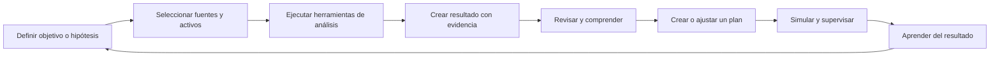

# Visión y pilares

## Propósito

Construir una plataforma personal de análisis de inversiones que pueda crecer hasta convertirse en un servicio para profesionales y usuarios menos experimentados. La aplicación reúne información de fuentes autorizadas, ejecuta cálculos y procesos reproducibles, conserva el contexto obtenido y presenta conclusiones comprensibles antes de permitir cualquier acción externa.

El valor no está en que una IA “adivine el mercado”. Está en reducir el trabajo manual necesario para recopilar información, contrastarla, aplicar métodos, vigilar cambios y entender por qué un resultado o una acción tiene sentido.

## Qué estamos creando

La aplicación tendrá un panel donde el usuario pueda:

- conectar o seleccionar fuentes de información;
- organizar activos, listas de seguimiento, hipótesis y estrategias;
- solicitar análisis y consultar su evidencia;
- crear planes con reglas, límites y condiciones;
- revisar tareas y resultados producidos por herramientas internas;
- simular decisiones antes de utilizar dinero real;
- en fases posteriores, autorizar acciones sobre una cuenta externa compatible.

No llamaremos “bot” a todo el sistema. Una automatización es un plan explícito que activa herramientas autorizadas bajo reglas y límites. Las capacidades de IA pueden preparar, interpretar o coordinar tareas, pero las operaciones financieras se realizan mediante servicios deterministas de la aplicación y APIs externas auditables.

## Vocabulario de trabajo

| Término | Significado en este producto |
| --- | --- |
| Usuario | Persona autenticada que consulta, analiza, configura o autoriza acciones. |
| Portafolio observado | Representación local de activos y posiciones importadas o creadas para análisis. No implica custodia. |
| Fuente de datos | API, documento, evento o conjunto de datos autorizado que aporta información al sistema. |
| Activo | Valor, ETF, criptomoneda u otro instrumento identificado de forma inequívoca. |
| Tesis | Explicación estructurada de por qué un activo o estrategia merece seguimiento. |
| Análisis | Artefacto reproducible que combina un objetivo, fuentes, cálculos, resultados, interpretación y límites. |
| Plan | Conjunto de reglas, condiciones, frecuencia, límites y acciones previstas. |
| Ejecución | Uso de una herramienta interna o API externa para realizar una operación autorizada. |
| Evidencia | Datos, referencias, parámetros y resultados que permiten evaluar una conclusión o acción. |
| Herramienta | Operación de la aplicación con entrada y salida estructuradas: consultar precios, calcular métricas, guardar un análisis o enviar una orden. |
| Capacidad de IA | Componente con un objetivo y herramientas permitidas; no equivale necesariamente a un modelo distinto. |
| Tarea | Solicitud registrada con objetivo, contexto autorizado, estado, resultado y trazabilidad. |

## Pilares fundamentales

1. **Evidencia antes que confianza.** Cada resultado debe mostrar de dónde salió, qué se calculó y qué limitaciones tiene.
2. **Cálculo reproducible.** Los precios, indicadores, comparaciones y límites se procesan mediante código y datos versionados; la IA los interpreta, no los inventa.
3. **Acción bajo autorización.** Una capacidad de IA no obtiene permiso implícito para operar. Las acciones externas respetan alcance, confirmación, límites y revocación.
4. **Especialización con contexto compartido.** Distintas capacidades realizan investigación, análisis, planificación o supervisión y guardan resultados estructurados que otras capacidades autorizadas pueden reutilizar.
5. **Transparencia para principiantes y profesionales.** La interfaz puede resumir un análisis, pero siempre permite examinar sus fuentes, reglas y cálculos.
6. **Progresión segura.** Primero observamos y explicamos; después simulamos; solo más adelante ejecutamos con dinero real.
7. **Cuentas externas y fondos separados.** La aplicación no necesita custodiar dinero para aportar valor. Las cuentas permanecen en proveedores financieros compatibles.
8. **Producto antes que infraestructura.** Una tecnología se adopta porque satisface un requisito comprobado, no porque permita imaginar más funciones.

## Bucle principal de valor

La primera versión debe demostrar este ciclo sin conectarse a una cuenta real ni prometer rentabilidad.

