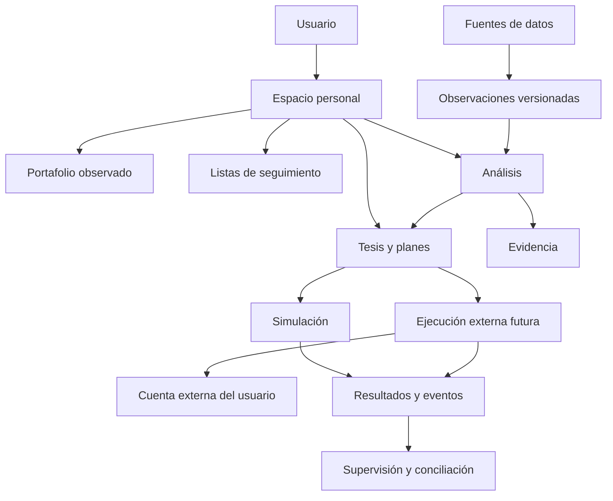
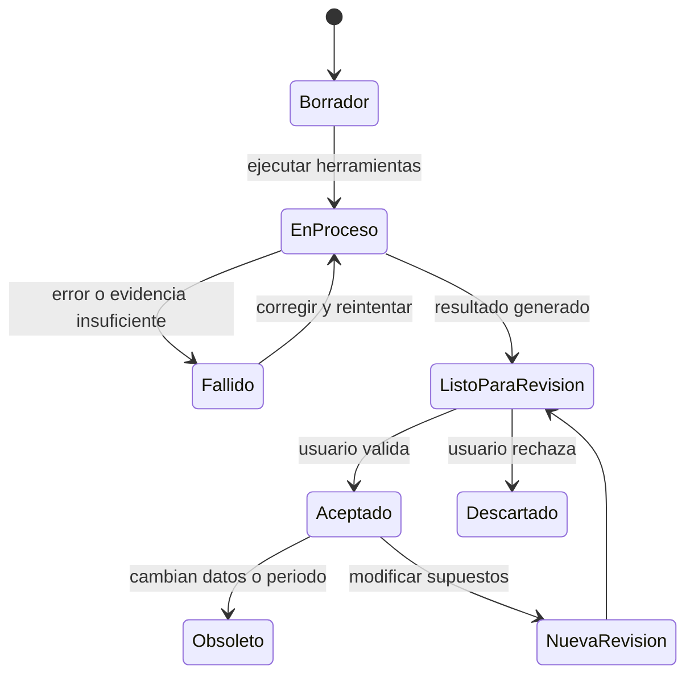

# Dominio y capacidades

## Mapa conceptual

## Entidades iniciales

| Entidad | Responsabilidad |
| --- | --- |
| Usuario | Identidad, preferencias, nivel de explicación y autorizaciones. |
| Espacio personal | Contenedor principal de información y configuraciones del usuario. |
| Fuente | Describe origen, cobertura, licencia, actualización y estado de una integración. |
| Activo | Identidad canónica de un instrumento y referencias en distintos proveedores. |
| Observación | Dato obtenido en un momento concreto: precio, métrica, noticia o evento. |
| Lista de seguimiento | Conjunto de activos que el usuario desea observar. |
| Tesis | Hipótesis con argumentos, riesgos, condiciones de invalidación y evidencia asociada. |
| Análisis | Resultado versionado de una pregunta y un proceso reproducible. |
| Plan | Reglas evaluables, límites y acciones propuestas. |
| Tarea | Unidad de trabajo con estado y resultado; puede ejecutar una o varias herramientas. |
| Autorización | Permiso explícito para una acción, alcance, duración y cuenta concreta. |
| Evento de ejecución | Intento, respuesta, error o confirmación de una herramienta interna o externa. |

## Estados de un análisis

Un análisis aceptado no se sobrescribe. Una modificación crea una revisión enlazada y conserva los datos y parámetros que produjeron el resultado anterior.

## Capacidad de acción por nivel

| Nivel | Qué puede hacer el sistema | Confirmación esperada |
| --- | --- | --- |
| Observar | Consultar fuentes, importar datos y detectar cambios. | Consentimiento al conectar la fuente. |
| Analizar | Ejecutar cálculos, comparar escenarios y crear resultados. | Solicitud del usuario o tarea recurrente autorizada. |
| Preparar | Crear un plan, alerta o borrador de acción. | Revisión antes de activarlo. |
| Simular | Evaluar un plan con datos históricos o un entorno de prueba. | Activación explícita del plan simulado. |
| Ejecutar | Enviar una instrucción a una cuenta financiera externa. | Autorización específica, límites activos y reglas del proveedor. |

## Reglas de integridad

- Cada observación conserva proveedor, instante, zona horaria, instrumento y versión o identificador disponible.
- Una conclusión enlaza la evidencia utilizada; no depende únicamente del texto de una conversación.
- La capa de IA no escribe directamente posiciones, órdenes o autorizaciones: invoca casos de uso que validan las reglas.
- Las credenciales externas nunca forman parte del contexto de un modelo.
- Una tarea repetida debe ser idempotente cuando pueda producir efectos duplicados.
- Los datos importados de una cuenta externa se distinguen de los datos estimados o simulados.

