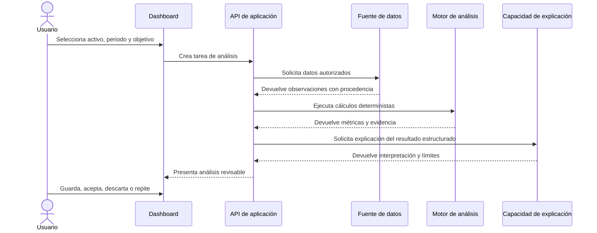
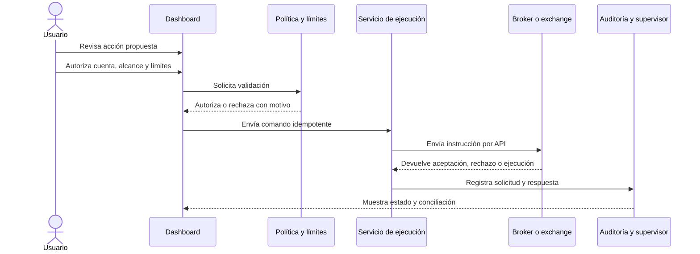

# Requisitos y recorridos

Las prioridades describen el orden del producto: `Primera entrega` demuestra valor sin dinero real; `Núcleo` amplía el análisis y la planificación; `Después` añade automatización controlada; `Futuro regulado` exige validación técnica, contractual y legal adicional.

## Requisitos funcionales

| ID | Prioridad | Requisito |
| --- | --- | --- |
| RF-01 | Primera entrega | Un usuario puede autenticarse y acceder únicamente a su espacio personal. |
| RF-02 | Primera entrega | El usuario puede crear y organizar listas de seguimiento con activos compatibles. |
| RF-03 | Primera entrega | El sistema puede consultar al menos una fuente de datos y registrar su procedencia y fecha. |
| RF-04 | Primera entrega | El usuario puede solicitar un análisis sobre un activo, periodo y objetivo definidos. |
| RF-05 | Primera entrega | El análisis entrega datos, cálculos, interpretación, riesgos y límites en secciones distinguibles. |
| RF-06 | Primera entrega | El usuario puede guardar, aceptar, descartar o volver a ejecutar un análisis sin sobrescribir el anterior. |
| RF-07 | Primera entrega | El dashboard muestra tareas recientes, resultados, fallos y estado de las fuentes utilizadas. |
| RF-08 | Núcleo | El usuario puede crear una tesis con argumentos, riesgos y condiciones de invalidación. |
| RF-09 | Núcleo | El usuario puede transformar una tesis o análisis en un plan con reglas y límites explícitos. |
| RF-10 | Núcleo | El sistema puede comparar activos, periodos o escenarios usando parámetros conservados. |
| RF-11 | Núcleo | Una tarea programada puede actualizar datos o análisis con alcance y frecuencia definidos. |
| RF-12 | Núcleo | El usuario puede revisar qué capacidad de IA y qué herramientas participaron en un resultado. |
| RF-13 | Después | El usuario puede ejecutar un plan en simulación y consultar operaciones, rendimiento y diferencias frente a sus reglas. |
| RF-14 | Después | El supervisor detecta errores, datos obsoletos, duplicados, incumplimiento de límites y divergencias entre plan y simulación. |
| RF-15 | Después | Una integración externa usa permisos mínimos, puede desconectarse y muestra su estado sin revelar secretos. |
| RF-16 | Futuro regulado | El usuario puede autorizar el envío de órdenes a una cuenta externa compatible dentro de límites previamente aceptados. |
| RF-17 | Futuro regulado | El sistema puede pausar, cancelar cuando sea posible y conciliar operaciones externas con registros internos. |
| RF-18 | Futuro regulado | Toda recomendación o acción personalizada se habilita únicamente dentro del marco legal y contractual aprobado para el producto. |

## Requisitos no funcionales

| ID | Requisito |
| --- | --- |
| RNF-01 | La API aplica identidad, propiedad y permisos en cada operación; ocultar controles en la interfaz no es seguridad. |
| RNF-02 | Cada análisis conserva objetivo, fuente, instante de los datos, parámetros, herramientas y versión del proceso. |
| RNF-03 | Los cálculos financieros importantes son deterministas y comprobables fuera del modelo de IA. |
| RNF-04 | El sistema distingue hechos observados, cálculos, inferencias e hipótesis. |
| RNF-05 | Una acción externa, económica o irreversible requiere una autorización válida y un registro de auditoría. |
| RNF-06 | Secretos, tokens y credenciales se cifran y nunca se incluyen en prompts, logs o resultados visibles. |
| RNF-07 | Las operaciones con efectos admiten claves de idempotencia, control de reintentos y conciliación. |
| RNF-08 | El usuario puede conocer el costo, estado y resultado de una tarea de IA o integración. |
| RNF-09 | Cuando faltan datos o existe evidencia contradictoria, el resultado lo declara en vez de completar huecos como hechos. |
| RNF-10 | Las integraciones respetan licencias, límites de uso y derechos de visualización de cada proveedor. |

## Recorrido de la primera entrega

## Recorrido futuro de una acción externa

## Criterio de primera entrega útil

Una persona puede iniciar sesión, crear una lista, solicitar un análisis de un activo usando datos reales permitidos, revisar de dónde salió cada resultado y conservarlo. No requiere automatización, RAG, varias IAs encadenadas, broker, criptomonedas ni ejecución real.

