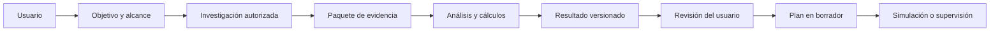

# IA, herramientas y evidencia

## Decisión de producto

La aplicación tendrá varias **capacidades de IA**, cada una con un contrato y herramientas permitidas. Pueden usar el mismo modelo o proveedores diferentes. La separación existe por responsabilidad y permisos, no para multiplicar agentes sin necesidad.

| Capacidad | Responsabilidad | Resultado esperado |
| --- | --- | --- |
| Asistente de producto | Ayudar a navegar, configurar y expresar una intención. | Orientación o borrador revisable. |
| Investigador | Reunir información de fuentes autorizadas y extraer afirmaciones citables. | Paquete de evidencia estructurado. |
| Analista | Convertir un objetivo y evidencia en cálculos, comparaciones y hallazgos. | Análisis reproducible. |
| Planificador | Traducir una tesis aceptada en reglas, condiciones y límites. | Plan en borrador. |
| Supervisor | Comparar el comportamiento observado con reglas, límites y resultados esperados. | Alertas, diagnóstico y propuesta de pausa. |
| Explicador | Adaptar un resultado ya calculado al nivel del usuario sin modificar los hechos. | Resumen y recorrido de evidencia. |

No es obligatorio implementar todas estas capacidades como procesos autónomos. En la primera entrega, varias pueden ser funciones del mismo flujo. Solo se separarán técnicamente cuando exista una diferencia real de permisos, contexto, costo, latencia o ciclo de vida.

## Cómo colaboran

Una capacidad no debe pasar a otra una conversación extensa como único contexto. Produce un artefacto estructurado y versionado que incluye objetivo, fuentes, resultado, incertidumbre y estado de revisión.

Una tarea puede originar otra tarea interna, pero la relación queda registrada. Esto permite reconstruir por qué se creó un resultado sin tratar el proceso como una cadena invisible de chats.

## Herramientas, no acceso directo

La IA no se conecta libremente a la base de datos ni a una cuenta financiera. Invoca herramientas con contratos limitados, por ejemplo:

- `buscar_activos(consulta)`;
- `obtener_historial(activo, periodo, granularidad)`;
- `calcular_metricas(dataset, parametros)`;
- `crear_analisis_borrador(resultado)`;
- `crear_plan_borrador(reglas)`;
- `consultar_estado_tarea(id)`;
- `solicitar_simulacion(plan_id)`.

Una herramienta valida identidad, permiso, esquema, costo y límites antes de ejecutarse. Las herramientas con efectos externos se mantienen fuera del conjunto disponible hasta que el producto tenga las garantías necesarias.

## Contrato mínimo de un resultado

| Campo | Propósito |
| --- | --- |
| Objetivo | Pregunta concreta que se intentó resolver. |
| Alcance | Activos, periodo, cuenta o conjunto de datos incluido. |
| Fuentes | Proveedor, identificador, instante y cobertura de los datos. |
| Método | Herramientas, cálculos, parámetros y versiones usados. |
| Evidencia | Valores, referencias y resultados intermedios relevantes. |
| Interpretación | Explicación que diferencia observación e inferencia. |
| Incertidumbre | Datos ausentes, contradicciones y límites del método. |
| Procedencia | Usuario, capacidad, tarea, fecha y revisiones. |
| Estado | Borrador, listo para revisión, aceptado, descartado u obsoleto. |

## Contexto compartido

SurrealDB conservará las entidades y relaciones que forman el estado oficial: usuarios, activos, tareas, análisis, planes, autorizaciones y auditoría. Qdrant podrá indexar representaciones semánticas de contenido autorizado para recuperación contextual.

Qdrant no será la fuente oficial de posiciones, órdenes, permisos ni resultados numéricos. Recuperar un fragmento por similitud no demuestra que sea verdadero, actual o aplicable; la capacidad que lo usa debe regresar a la fuente canónica y comprobarlo.

## Reglas compartidas

1. Una capacidad recibe el contexto mínimo para su tarea.
2. Sus permisos nunca superan los del usuario y la autorización activa.
3. Los cálculos importantes los ejecutan herramientas deterministas.
4. Los resultados de otra capacidad se consideran entradas con procedencia, no verdades incuestionables.
5. Una acción económica requiere una política externa al modelo y confirmación según su riesgo.
6. Los errores parciales se muestran; no se rellenan silenciosamente.
7. El usuario puede inspeccionar la cadena de tareas sin necesitar leer razonamientos internos del modelo.

