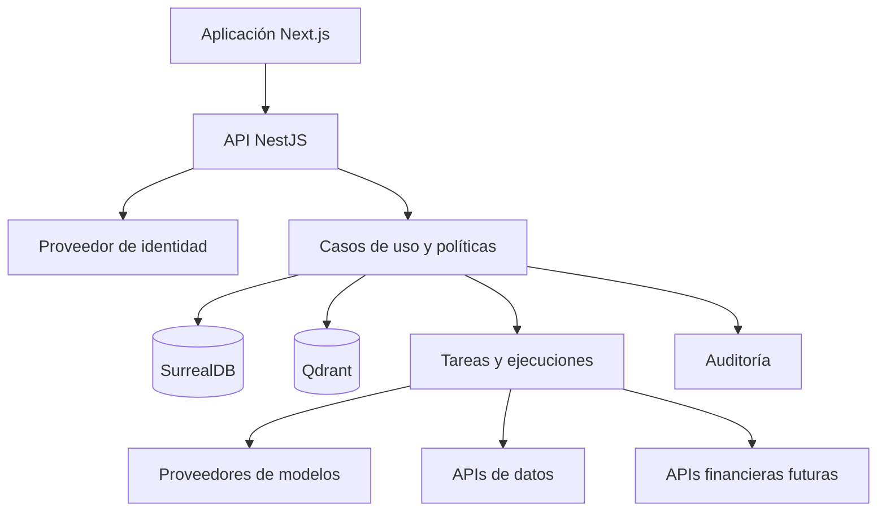

# Arquitectura y datos

Este documento fija límites iniciales, no una lista definitiva de servicios. La arquitectura debe crecer junto con recorridos que ya funcionen.

## Componentes previstos

## Responsabilidades

| Componente | Responsabilidad | No debe hacer |
| --- | --- | --- |
| Next.js | Interfaz, navegación, visualización y captura de intención. | Aplicar por sí solo permisos o ejecutar lógica financiera sensible. |
| NestJS | Casos de uso, autorización, validación, herramientas, tareas e integraciones. | Delegar reglas críticas a prompts. |
| Proveedor de identidad | Inicio de sesión, sesiones y, si se necesita, MFA. | Definir el dominio financiero de la aplicación. |
| SurrealDB | Estado canónico y relaciones del producto. | Actuar como memoria informal sin esquemas ni reglas. |
| Qdrant | Recuperación semántica de contenido permitido. | Ser sistema de registro para saldos, órdenes o permisos. |
| Proveedor de IA | Interpretación, extracción, planificación y explicación dentro de contratos. | Recibir secretos o ejecutar directamente contra cuentas. |
| Adaptadores externos | Traducir contratos internos a cada API de datos, broker o exchange. | Filtrar peculiaridades del proveedor hacia todo el dominio. |

## Identidad

Usaremos un servicio administrado para reducir el trabajo inicial. Clerk, Descope y Firebase Auth son candidatos. La elección debe comparar como mínimo:

- integración con Next.js y validación en NestJS;
- sesiones, renovación, revocación y MFA;
- exportación o migración de usuarios;
- organizaciones o roles si llegan a ser necesarios;
- webhooks, costo y experiencia local de desarrollo.

La identidad externa autentica al usuario. La API conserva la identidad interna, la propiedad de los datos y las autorizaciones del producto.

## Persistencia prevista

### SurrealDB

Será el candidato principal para datos estructurados y relaciones: usuarios internos, espacios, activos, fuentes, observaciones necesarias, análisis, revisiones, planes, tareas, autorizaciones y auditoría.

Antes de consolidarlo se debe demostrar en un incremento pequeño: migraciones o versionado de esquema, restricciones importantes, consultas habituales, transacciones necesarias, copias de seguridad y funcionamiento del SDK elegido.

### Qdrant

Se incorporará cuando exista una necesidad concreta de recuperación semántica. Puede indexar documentos, fragmentos de investigación y análisis autorizados junto con metadatos de acceso y versión.

No es necesario para la primera consulta de precios ni para guardar un análisis. Se añade cuando la búsqueda por relaciones y campos normales deje de cubrir el recorrido.

## Integraciones externas

Cada integración se implementa detrás de un puerto interno y declara:

- propósito y datos utilizados;
- operaciones de lectura y escritura;
- credenciales y permisos mínimos;
- límites de frecuencia y costos;
- idempotencia y reintentos;
- webhooks o método de sincronización;
- licencia y derecho de mostrar los datos;
- mecanismo de desconexión y eliminación.

La primera integración debe ser una fuente de datos de solo lectura o un entorno de simulación. Una API de ejecución real no es una dependencia inicial.

## Regla de crecimiento

No se crearán de antemano microservicios, un orquestador general, múltiples colas ni una infraestructura de agentes distribuida. Comenzaremos con módulos claros dentro de la API y un mecanismo de tareas cuando un proceso realmente sea asíncrono. Una separación física se justificará con aislamiento, escala, seguridad o operación demostrables.

