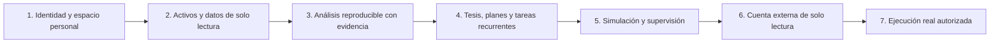

# Fases, límites y decisiones

## Secuencia propuesta

Cada fase debe producir un recorrido utilizable y verificarse antes de comenzar la siguiente.

## Primer incremento recomendado

**Objetivo:** un usuario autenticado puede crear una lista de seguimiento y guardar activos manualmente.

Este incremento enseña y valida identidad, usuario interno, propiedad, API, persistencia y dashboard sin introducir todavía datos financieros, Qdrant ni IA.

## Segundo incremento

**Objetivo:** consultar un activo desde una fuente de solo lectura y mostrar precio, instante, proveedor y estado de la petición.

Este incremento establece el patrón de adaptadores externos y procedencia de datos.

## Tercer incremento

**Objetivo:** generar un análisis sencillo y reproducible sobre datos obtenidos, con uno o dos cálculos deterministas y una explicación asistida.

Solo después de este punto tendremos evidencia para decidir qué contexto semántico, tareas asíncronas o capacidades de IA adicionales hacen falta.

## Fuera de la primera entrega

- Conectar Binance, un broker o una cuenta con dinero real.
- Enviar, cancelar o modificar órdenes.
- Elegir inversiones de forma autónoma para el usuario.
- Copiar operaciones entre usuarios.
- Custodiar fondos, permitir depósitos o retiros.
- Ofrecer private equity, activos alternativos o un mercado propio.
- Implementar todas las capacidades de IA como agentes separados.
- Entrenar un modelo o aplicar LoRA antes de demostrar una carencia concreta.
- Añadir Qdrant sin un recorrido que necesite búsqueda semántica.
- Prometer rendimiento o comercializar la plataforma como asesor automático.

## Condiciones antes de ejecutar con dinero real

1. Simulación y conciliación probadas con casos de error.
2. Límites de riesgo independientes del modelo de IA.
3. Idempotencia, reintentos controlados y parada de emergencia.
4. Gestión segura de credenciales y permisos mínimos.
5. Registros de autorización, órdenes y respuestas del proveedor.
6. Acuerdo e integración comercial permitida por el proveedor externo.
7. Revisión legal del flujo, comunicaciones y modelo de cobro en las jurisdicciones atendidas.
8. Términos, privacidad, retención y respuesta ante incidentes definidos.

## Decisiones abiertas

1. ¿Qué usuario será el primero: aprendizaje personal, inversor autónomo o desarrollador de estrategias?
2. ¿Cuál será la primera clase de activo: acciones y ETF de EE. UU. o criptomonedas?
3. ¿Qué fuente de datos permite el uso previsto y a qué costo?
4. ¿Qué primer análisis aporta valor real y puede verificarse con matemáticas sencillas?
5. ¿Qué proveedor de identidad ofrece el mejor equilibrio entre integración, control y costo?
6. ¿SurrealDB cumple las garantías necesarias después del primer prototipo de persistencia?
7. ¿Qué contenido necesitará búsqueda semántica y qué contenido nunca debe entrar en Qdrant?
8. ¿Qué tareas pueden ejecutarse automáticamente y cuáles siempre requieren confirmación?
9. ¿Qué explicaciones necesita un principiante y qué evidencia adicional espera un profesional?
10. ¿Cuál será el estado de residencia y el mercado inicial si el producto se ofrece a terceros?

## Criterio para añadir una función

Antes de incorporar una función nueva debemos poder responder:

- qué problema observable resuelve;
- quién la necesita ahora;
- qué datos y permisos utiliza;
- qué salida verificable produce;
- qué puede fallar y cómo se revierte o concilia;
- cómo sabremos que merece permanecer en el producto.

