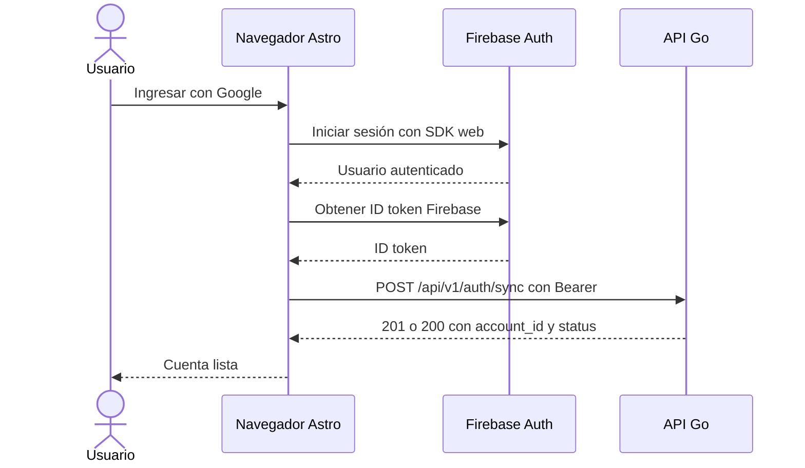

# 01 — Autenticación Google/Firebase y cuenta en la API Go

Fecha de creación: 2026-10-16
Última actualización: 2026-10-16
Estado: Plan en ejecución; UI y lógica inicial implementadas, recorrido Google real pendiente.
Ámbito: Primer recorrido de autenticación web.
Relacionada con: [configuración previa](../01-configuracion-antes-de-construir.md), [contrato real](../../fonts/auth/01-contrato-real-api-go.md), [Firebase oficial](../../fonts/auth/02-firebase-web-y-limites-del-cliente.md), [Astro y curso](../../fonts/astro/01-renderizado-islas-y-configuracion.md), [catálogo de UI](../../fonts/01-catalogo-cursos-astro-y-ui.md).
Revisión de referencia: web `e52268ae9daa83ea820c3d65cbd5783968c083e8`; API `fbb1bc0ba80e8f454a8e299bbc0688790cdf5d2d`, con cambios locales preexistentes.

## Resultado buscado y responsabilidades

Una persona inicia Google en el navegador, prepara su cuenta interna en Go y accede a una vista mínima de cuenta. Al salir o cambiar de identidad, desaparecen la cuenta y los datos de la sesión anterior. No se necesita otro backend auth en Astro para ese recorrido. [Contrato F-B2/F-B3](../../fonts/auth/01-contrato-real-api-go.md)

| Parte | Responsabilidad |
| --- | --- |
| Astro | Páginas, layout y carga del código cliente necesario. |
| Firebase web | Google, sesión del navegador y obtención del ID token. |
| Cliente HTTP propio | URL base, Bearer, timeout/cancelación, lectura de JSON y errores tipados. |
| Estado de UI | Restauración, entrada, preparación de cuenta, cuenta lista y errores recuperables. |
| Go | Verificación Firebase, proveedor Google, cuenta, suspensión y persistencia SQL. |

Esta separación es propuesta del proyecto apoyada por el contrato existente. **Vue es el framework elegido para la UI**, con `Vue con Pinia y Testing` y `Vue 3 con TypeScript y Quasar` como referencias complementarias. Aplicar la [filosofía de trabajo](../02-filosofia-vue-y-prioridad-de-fuentes.md) también al estado, transporte y arquitectura: primero ambos cursos Vue, segundo React, tercero Svelte excepcional y cuarto otros cursos pertinentes. La librería concreta de estado se elegirá por necesidad; consultar esos cursos no obliga a instalar Pinia, Quasar ni las dependencias de otros ejemplos.

## Flujo propuesto

Tras un login explícito, sincronizar mediante POST. En restauración, esperar al observador del SDK y consultar GET `/auth/me`; solo `404 account_not_synced` dispara POST `/auth/sync`. Un `404` genérico de ruta mal formada no crea cuenta por inferencia. Obtener el token actual antes de cada petición autenticada. [F-F3/F-F4](../../fonts/auth/02-firebase-web-y-limites-del-cliente.md), [F-B3](../../fonts/auth/01-contrato-real-api-go.md)

## Incrementos y criterios de cierre

1. **Configuración y sonda:** completar los incrementos 0–2 del plan previo. Cerrar con entorno válido y rechazo sin token comprobado desde navegador/preflight. Si SQL/migraciones impiden iniciar Go, registrar ese estado en la API antes de declarar lista la conexión.
2. **Google y cuenta:** implementar entrada, carga, cancelación y resultado del popup; obtener ID token y llamar a sync. Cerrar con cuenta nueva y acceso repetido que conservan `account_id`. La UI solo queda lista después de la respuesta Go, no por la mera existencia de `user` Firebase.
3. **Restauración y fallos:** implementar GET y sincronización selectiva, estado inicial de comprobación, timeout y reintento explícito. Cerrar con recarga, cuenta no sincronizada, error de red, `401`, `403` y `503` diferenciados.
4. **Salida y cambio de cuenta:** cancelar o invalidar peticiones pendientes y limpiar perfil/cachés privados. Comprobar logout durante sync/me y Alice → logout → Bob; una respuesta tardía no puede restaurar el perfil anterior. Salir localmente no se presenta como revocación global en Go: no existe endpoint para ello en el router actual.

Cada incremento aplicado tendrá su entrada de bitácora con originales, guías utilizadas, archivos y comprobaciones reales. Se repetirá `reconstruir-codigo-curso` tantas veces como requiera la necesidad, sin máximo arbitrario de lecciones o guías: una guía independiente por original, incluso si hace falta recorrer todas las lecciones pertinentes de una sección o curso. Aplicar la [regla del plan 02](../02-filosofia-vue-y-prioridad-de-fuentes.md); los prerrequisitos se consultan cuando falte contexto y se conserva la prioridad de fuentes vigente.

## Política propuesta de errores

| Situación | Resultado de UI previsto |
| --- | --- |
| Popup cancelado | Entrada disponible, sin cuenta parcial. |
| Popup bloqueado o Google indisponible | Error recuperable; explicar cómo reintentar. |
| `401 invalid_token` | Obtener token renovado y reintentar como máximo una vez si hay sesión; si vuelve a fallar, pedir nueva autenticación. |
| `403 account_suspended` | Bloquear acceso y mostrar suspensión; no bucle de sync ni nuevo login automático. |
| `404 account_not_synced` de GET | Un POST sync y procesar su respuesta. |
| `503 auth_unavailable` o `storage_unavailable` | Conservar sesión Firebase; cuenta no lista, reintento acotado/expreso. |
| Timeout, respuesta no JSON o forma de cuenta inválida | Fallo de integración recuperable, sin inventar una cuenta. |
| Logout/cambio de usuario con respuesta tardía | Descartar esa respuesta y mantener el estado de la identidad actual. |

Los códigos reales se documentan en F-B3. Las políticas de UI son decisiones propuestas, no comportamiento ya implementado. Verificar revocación/expiración reales por el límite observado en el verificador. No renovar por `403` ni tratar automáticamente un `503` como sesión inválida.

## Verificación prevista y límites

Ejecutar build y verificaciones existentes pertinentes. Comprobar el recorrido real en navegador con el entorno acordado: Google, cancelación, token, cuenta nueva/repetida, recarga, salida, errores y otra cuenta. No crear una suite extensa por activar las skills; diseñar pruebas focalizadas si el incremento las necesita.

Fuera del primer recorrido: email/contraseña, Auth.js/Better Auth, Firebase Admin en Astro, permisos o endpoints nuevos, datos SQL directos desde web, broker, pagos, análisis y dashboard completo. La protección cliente evita mostrar estados privados, mientras Go conserva la autoridad sobre los datos. Requerir HTML privado renderizado por servidor obligaría a planificar otra arquitectura de sesión.

La preparación inicial solo inspeccionó fuentes. El [incremento auth 01](../../../bitacora-construccion/auth/01-acceso-google-vue-y-cuenta-go.md) implementa UI, SDK y cliente; registra build, tipos, 18 pruebas con dobles y sondas Go en 8081. No se ejecutaron migraciones ni autenticación Google real. Los cierres que exigen identidad real siguen pendientes.
